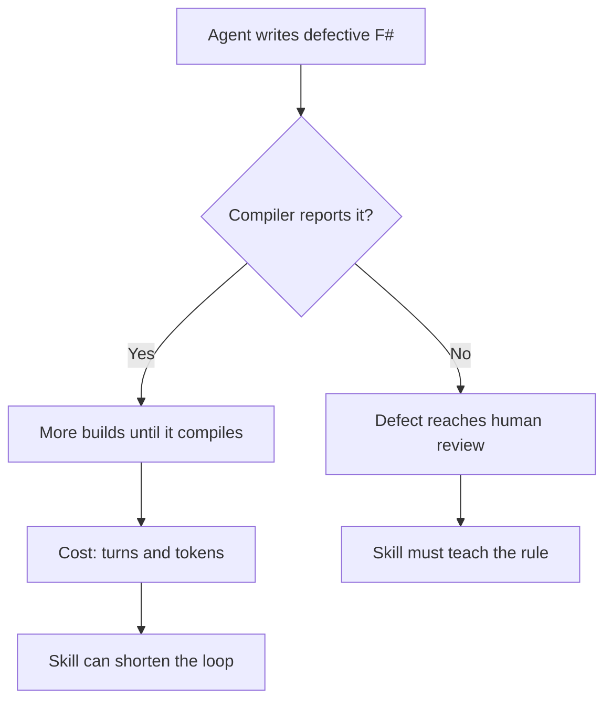

# Agent F# failure evidence

This file records where coding agents fail when they write F#.
Each skill ticket in the evidence series uses this file as its evidence source.
The raw extracts are not kept. This file holds the complete data.
See [practices](practices.md) for eval design and [terminology](terminology.md) for shared terms.

## Sources

The research ran on 2026-10-10.

- **PR reviews:** `experiad/motivity`, 247 non-dependabot PRs, 3,494 comments, 89 agent-related PRs, 160 human F# review comments.
- **Claude Code sessions:** 299 sessions on this machine, 34 with real compiler diagnostics.
- **Codex sessions:** 2,689 rollouts scanned (496 guardian sessions excluded). The `build-times` repository is excluded because it holds compiler-variant experiments (15,205 of 16,339 FS0039 hits).
- **opencode sessions:** 598 sessions from `storage/` JSON. The `opencode.db` file was missing.

## Compiler column

"Compiler" means the compiler reports the problem.
If it does, the agent fixes it after more builds, and the cost is turns and tokens.
If it does not, the defect reaches human review.



## Ranked areas

| # | Area | PR reviews | Claude sessions | Codex / opencode | Compiler | Skill |
|---|---|---|---|---|---|---|
| 1 | Task / Async / ValueTask / CE composition | thin | Task vs Async mismatch, `ContinueWith().Unwrap()` | FS0193 (93 sessions), FS3501/3511, user correction: "This should be using valueTask computation expression instead of task CE" | Partly | `fsharp-async-composition` |
| 2 | Partial functions and hidden failures (`List.head`, `failwith`, silent `defaultArg`, swallowed errors) | strong (top category) | — | reversed `requireTrueWith`, `List.head` drops accumulated errors | No | `fsharp-failure-paths` |
| 3 | Invented, moved, or unresolved APIs; missing opens | missed reuse of helpers | FS0039 (62, top code) | FS0039 (200 sessions), FS0074, FS0078; 177 sessions had 4+ failed builds | Yes | `fsharp-verify-api` |
| 4 | Speculative code, missed reuse, comment noise | strong (top category) | — | spec gaps: ignored parameters | No | None (not F#-specific) |
| 5 | Weak or false-positive tests | thin | bool as test body, xUnit `Assert.Equal` overloads | ~11 sessions | No | None (`dotnet-test-audit` covers it) |
| 6 | .NET 10 nullness (FS3261) | — | 20 hits (`Uri.TryCreate`, `JsonElement.GetString`) | 435 hits in 37 sessions; 61% in 3 sessions | Yes (warning) | `fsharp-nullness-interop` |
| 7 | Idiomatic shape: tuples over records, if/else or `mutable` over `match`, multi-pass collections | strong | — | 5 user corrections | No | `fsharp-idiom-review` |
| 8 | Resource lifetime, disposal, subscription ownership | thin | — | ~34 sessions (reviews + FS0524) | No | None yet (one source) |
| 9 | New BCL overloads break inference (FS0041, FS0001) | — | `TimeSpan.FromSeconds` | FS0041 (91 sessions) | Yes | Part of `fsharp-nullness-interop` |
| 10 | Offside / indentation (FS0010, FS0058) | — | 23 hits | 112 sessions, spread evenly | Yes, fixed in one turn | None |
| 11 | Missing record fields (FS0764), incomplete matches (FS0025) | modeling comments | — | 30 / 21 sessions | Yes | None (`parse-dont-validate` covers modeling) |
| 12 | `.fsx` hygiene (`#r` paths, `#r nuget` in non-interactive FSI) | thin | FS0078 | FS0078 (38 sessions) | Yes | Part of `fsharp-verify-api` |

No source showed Fantomas, SRTP/IWSAM, `.fsproj` compile-order, or logging-format problems.

## Skill mapping

| Skill | Areas | Main risk |
|---|---|---|
| `fsharp-async-composition` | 1 | Partly silent: wrong CE or blocking composition compiles. |
| `fsharp-failure-paths` | 2 | Silent: defects reach human review. |
| `fsharp-verify-api` | 3, 12 | Reported: many failed builds before the code compiles. |
| `fsharp-nullness-interop` | 6, 9 | Reported: warnings and inference errors on new BCL APIs. |
| `fsharp-idiom-review` | 7 | Silent: reviewers ask for a different shape. |

Areas 4, 5, 8, 10, and 11 have no F# skill.
Area 4 is not F#-specific. Area 5 is covered by `dotnet-test-audit`.
Area 8 has only one source. Area 10 is fixed in one turn.
Area 11 is covered by `parse-dont-validate` for modeling.

Example of a silent area 2 defect that the compiler accepts:

```fsharp
let firstError (errors: string list) =
    List.head errors // throws on an empty list; review flagged this pattern
```

Example of a reported area 6 diagnostic on .NET 10:

```fsharp
let name = element.GetString() // FS3261: result is string | null
```

## Evidence limits

- Cascading errors make the FS0039 and FS0001 counts larger. An Orleans 3 → 8 migration in `motivity` causes much of them.
- FS3261 and FS0074 hits come mostly from 3 sessions each.
- Many Codex subagent review messages are `encrypted_content`. Only 66 `[P0-3]` review findings were readable.
- Human correction messages are rare: 41 in Codex sessions.
- opencode is under-represented.

Use session counts, not hit counts, to compare areas. Hit counts favor a few long sessions.
A low count for a silent area does not mean the area is rare. Sessions record compiler output, not review defects.
