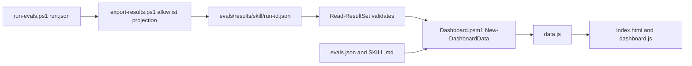

# Eval dashboard

The eval dashboard is a static page. For each skill, task, and target, it compares runs with the skill and runs without it. Commands and parameters are in [evals/README.md "Dashboard"](../evals/README.md#dashboard). This file keeps the data shapes, the verdict table, and the invariants.

## Current state

- A maintainer exports one result folder to `evals/results/<skill>/<run-id>.json` and commits it. The result sets are the only source of dashboard data.
- `evals/dashboard/build-dashboard.ps1` reads the result sets, the `evals/*/evals.json` files, and the `description` of each `SKILL.md`. It writes `data.js` and copies the page files.
- `.github/workflows/eval-dashboard.yml` runs `Dashboard.Tests.ps1` and `Metrics.Tests.ps1`, builds the page, and deploys it to GitHub Pages. It runs on a push to `master` that changes one of: `evals/results/**`, `evals/dashboard/**`, `evals/lib/**`, `evals/export-results.ps1`, `evals/run-evals.ps1`, `evals/tests/**`, `evals/*/evals.json`, `skills/*/SKILL.md`, `.github/workflows/eval-dashboard.yml`. The `Documented workflow triggers` test keeps this list and `evals/README.md` in step with the workflow.
- `evals/results/` has no result sets until the first export. The page then lists each skill with "No results yet".



## Data shapes

| Shape | Where | Fields |
|---|---|---|
| Result set | `evals/results/<skill>/<run-id>.json` | `schemaVersion` (1), `skill`, `runId`, `runs` (list of projected runs). |
| Projected run | `ConvertTo-ProjectedRun` in `evals/lib/Results.psm1` | An allowlist of `run.json`: `target`, `agent`, `model`, `resolvedModel`, `task`, `mode`, `run`, `invocation`, `isolated`, `startedAt`, `skillCommit`, `skillDirty`, `exitCode`, `timedOut`, `seconds`, `inputTokens`, `outputTokens`, `costUsd`, `turns`, `failedBuilds`, `skillUsed`, `globalSkillUsed`, `checks` (`text`, `passed`). |
| Mode stats | `Get-ModeStats` | `runs`, `counted`, `notLoaded`, `passRate`, `allPassRuns`, `meanSeconds`, `meanTokens`, `meanTurns`, `meanFailedBuilds`, `meanCostUsd`. A value is `null` when there is no data. |
| Comparison | `New-Comparison` | `runId`, `startedAt`, `date` (the day of `startedAt`, or of the run ID when `startedAt` is `null`), `skillCommit`, `skillDirty`, `resolvedModel`, `with`, `without` (mode stats), `verdict`, `checks` (per check text: passed and total for each mode). |
| Dashboard data | `New-DashboardData` | `schemaVersion`, `generatedAt`, `commit`, `repoUrl`, `thresholds`, `skills` > `tasks` > `targets`. Each target entry is one target and one exact model: `target`, `agent`, `resolvedModel`, `superseded`, `latest`, and `history` (comparisons, oldest first). `superseded` is true when the `latest.runId` of the entry is older than the newest `latest.runId` of another entry of the same target and task, so the page can label a row of an older model. |

A comparison key is skill, task, target, exact model, and run ID. Runs of one target with two models make two entries, because pooled runs would show a model change as a skill effect.

```json
{ "schemaVersion": 1, "skill": "fsharp-failure-paths", "runId": "20261102-100000",
  "runs": [ { "target": "claude:sonnet", "resolvedModel": "claude-sonnet-5-5", "task": "invoice", "mode": "with",
              "skillUsed": true, "checks": [ { "text": "Builds", "passed": true } ] } ] }
```

## Verdict table

`$VerdictRules` in `evals/dashboard/Dashboard.psm1` is an ordered table. The first rule that matches gives the verdict. `$Thresholds` at the top of the module holds the numbers.

| Order | Direction | Matches when |
|---|---|---|
| 1 | `not-comparable` | The pass-rate delta is `null`: a mode has no run, a mode has no counted run, or no counted run has a graded check. |
| 2 | `better` | Delta is at least +0.10. |
| 3 | `worse` | Delta is at most -0.10. |
| 4 | `less-effort` | Mean failed builds are lower by 1 or more, or mean turns are lower by 25% or more. |
| 5 | `no-change` | Always. |

`underpowered` is true when the smaller counted-run count of the two modes is below 3. It does not change the direction. `reason` is one sentence with the numbers.

## Invariants

- The projection is the privacy boundary. It keeps an allowlist of fields. It drops `workspace`, `command`, and the check evidence, which hold local paths and user names. It never rewrites text. `ConvertTo-ProjectedRun` passes every retained string (`$ProjectedTextKeys` and check text) to `Test-LocalPath`, and it throws when the string holds a backslash, `~/`, a drive prefix `X:/` (one letter, not after a letter or digit), a word that starts with one or more `/` (after the start of the string, whitespace, a quote, a backtick, `(`, `[`, `=`, or `,`, and followed by a character that is not a space or `/`), or the user name as a whole word without case (3 or more characters). The user name comes from the export's `-UserName` parameter, which defaults to `[Environment]::UserName`. An empty value turns off the user-name check for a user name that is also a common word or an agent name. The export then writes no file. The error names the run and the field and does not repeat the text. The unknown-model error names a private target as `<target>`. The maintainer fixes the grader. Add a field to `$ProjectedRunKeys` only after you check that it holds no local data. Add a text field to `$ProjectedTextKeys` as well.
- `Read-ResultSet` validates the schema version, the run ID form, the mode, a non-empty `resolvedModel`, and the keys in `$RequiredRunKeys` (`target`, `agent`, `task`, `mode`, `run`, `skillUsed`, `resolvedModel`, `checks`). It fills every other key of `$ProjectedRunKeys` with `$null` when a run lacks it, so a new allowlist key does not invalidate result sets that are already committed. Code after it trusts the shape.
- A with-skill run counts only when `skillUsed` is true. This is the rule of `Write-Summary` in `evals/lib/Agents.psm1`. A run that did not load the skill compares the agent with itself.
- Every row names the exact model. The runner records an empty `resolvedModel` when the model is unknown (no model in a Claude transcript, or a Codex `profile` key with no `-m` value), never the target alias. The runner reads the Codex and opencode model before `Invoke-Agent`, and the Claude model from the transcript after the run. The `profile` guard of `Get-ResolvedModel` tests for the key, not for a value form. The export fails when a run has no `resolvedModel` and `-ResolvedModel` has no entry for its target. `Read-ResultSet` rejects an empty `resolvedModel`.
- The pass-rate delta is rounded to 4 decimals before the comparison. Without it, 0.9 minus 0.8 is below 0.10 in floating point.
- The latest comparison is the result set with the highest run ID. Run IDs are `yyyyMMdd-HHmmss`, so text order is time order. The export and `Read-ResultSet` reject any other form.
- The page builds all DOM nodes with `textContent` and `createElement`. Check text is untrusted and never goes through `innerHTML`.
- `Get-SkillProvenance` (`evals/lib/Agents.psm1`) reads `skillCommit` and `skillDirty` for each run, just before the agent starts. `skillDirty` covers `skills/<skill>`, `evals/<skill>`, and `evals/lib`. A regrade keeps the original `skillCommit`, so a changed grader shows in `skillDirty` only for new runs.
- `Write-FileAtomic` writes the result set to a temporary file in the same folder and moves it over the target. A failed or interrupted export keeps the previous file.
- An export of the same folder writes the same bytes: runs are sorted, there is no generation time, and dates are ISO 8601 UTC. `Format-IsoUtc` formats every date with the invariant culture, because a custom format uses the current culture (the time separator is a dot in `fi-FI` and the year is 2569 in `th-TH`).
- `ConvertFrom-Json` turns ISO dates into `DateTime`. `ConvertTo-IsoUtc` converts them back, so `grade-evals.ps1` can rewrite `run.json` without a change of instant.

## Lessons

- Residual privacy risk. A private word with no path syntax, for example a client name that a check prints alone, is not detected. A path that holds no backslash and does not start a word with `/` is not detected (`opencode:/x`). Review `git diff` of a new result set before you commit it. The rule blocked no grader text when it was written. `Dashboard.Tests.ps1` scans every `evals.json` rubric question and the check names in the graders to keep it that way.

- The verdict is a heuristic. With 3 counted runs, one run that goes from all checks passed to none moves the mean pass rate by 33 points. The page marks a comparison with fewer than 3 counted runs in a mode as "too few runs".
- `run.json` from before the dashboard has no `skill`, `startedAt`, or `skillCommit`. The export reads the skill from `evals.json` and keeps the other two as `null`.

See [eval design](eval-design.md), [eval effort metrics](eval-effort-metrics.md), and [terminology](terminology.md) for result set, comparison, and verdict.
