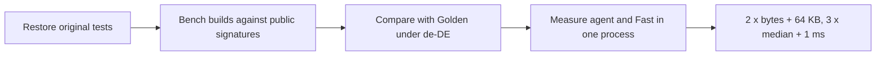
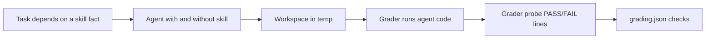

# Eval design

Skill evals live in `evals/<skill>/`, outside the skill directory, so installed skills do not carry them.
[evals/README.md](../evals/README.md) documents the runner, the task format, and the grader contract.
Related Lode files: [eval effort metrics](eval-effort-metrics.md), [eval rubric](eval-rubric.md), and [serialization eval](eval-serialization.md).

## Tasks

An eval task must depend on a skill fact that the agent cannot guess or check during a normal build. A cautious agent passed the first `fsharp-native-aot` tasks without the skill, so those tasks measured nothing.
A run with the skill counts only when the transcript shows that the agent loaded the skill.
Skill text must not contain the answer to its eval task. `fsharp-library-api-design` `classify-changes` is an accepted exception (see "Library API design grader"). The `fsharp-verify-api` reference teaches the lookup, not a table of moved members. Its examples and proof script use packages that no eval task uses.
Eval workspaces live in the temp directory. A parent `global.json` above this repository pins SDK 8, and a parent `Directory.Packages.props` turns on central package management.

A task for a compiler-caught skill needs a library version whose API differs from the one that models remember. A task that shows lift needs an API released after the models' training data.
The `fsharp-verify-api` tasks do not meet that need yet. The evidence is one run for each target and mode, so it is weak:

- `cli-options` uses `System.CommandLine` 2.0.0. Claude Sonnet and Codex pass it without the skill. With the skill, they use more turns (15 against 9, and 22 against 17). Only opencode passes it with the skill and fails it without the skill.
- `order-props` uses FsCheck 3.4.0, whose F# API moved to `FsCheck.FSharp`. Claude Sonnet and Codex pass it without the skill. With the skill, they use more turns (13 against 6, and 16 against 12) and more failed builds (2 against 0, and 3 against 0).
- Both graders check that the package version did not change. An agent can otherwise downgrade to the version that it remembers.
- `evals/fsharp-verify-api/tests/Grader.Tests.ps1` runs both graders against committed good, old API, stub, and downgrade workspaces, and checks each check result by name.

## Graders

Graders run the agent's output, for example as a JIT build and as a native exe.
Graders run `dotnet` from the project directory because `dotnet` selects its SDK from the working directory.
Before you use a grader, test it against a known good result and a known bad result.
Text rules in graders reject valid alternatives, for example `and` type declarations or a `Result` return. Prefer checks that run the agent's code. Grade a result folder again with `evals/grade-evals.ps1` after a grader fix.

Graders for silent defects use fault injection. A grader probe loads the agent's script, calls its functions with failing input, and prints `PASS` or `FAIL` for each case. `ConvertFrom-ProbeOutput` in `evals/lib/Grading.psm1` turns each such line into one check. `Get-ProbeScript` adds `open X.X` to the probe when the agent's script declares `module X =`, because FSI then loads it as a nested module.
A grader that matches error text accepts any error shape: a string, a list, or a union. It checks that the printed error names the cause, for example the missing key.
`Invoke-Capture -TimeoutSeconds <n>` stops the process tree of a command that runs longer than `n` seconds, and returns `TimedOut` and an exit code of -1. The output reads have the same deadline, because a child that outlives the command keeps the pipes open. On Windows, the helper then stops each child process that the command started, and the output is kept. On Linux and macOS, the call still returns at the deadline, but the child keeps running and the output can be lost. `evals/tests/Grading.Tests.ps1` checks the child and the output only on Windows. Use it for each run of agent code, because a blocked constructor or loop otherwise stops the grade.
A naive fix that wraps the result in `Result` but keeps the default, the catch-all handler, and `List.head errors` must fail the grader. Test the grader against that fix as well as against the original input and a known good result.

```powershell
$probe = Invoke-Capture dotnet @('fsi', 'Probe.fsx') -WorkingDirectory $dir
$results = @(ConvertFrom-ProbeOutput $probe.Lines)
$checks += New-Check 'Invoice.fsx and the probe compile together' ($probe.ExitCode -eq 0 -and $results.Count -gt 0)
$checks += $results
```

### Async semantics graders

Async semantics graders run the agent's code with a grader probe and fake dependencies. A cancellation grader checks that the inner work stops, not only that the task completes.
A ValueTask grader needs a pooled `IValueTaskSource` that resets on `GetResult`. A `Task`-backed `ValueTask` hides a second read.

### Nullness graders

The nullness eval graders build the agent's project with `Nullable=enable` and `TreatWarningsAsErrors=true` forced as global properties, read `Nullable`, `OtherFlags`, `TreatWarningsAsErrors`, `NoWarn`, `WarningsNotAsErrors`, `WarningLevel`, and `LangVersion` for `Release` with `dotnet msbuild -getProperty`, and run a driver with null inputs.
The settings check also requires every target framework to be `net10.0` or later, so a lower target cannot avoid the .NET 9 overloads. Nullness counts as on with `Nullable=enable` or `--checknulls+`, and as off when `OtherFlags` holds `--checknulls-`. A `--nowarn` for 3261 or 3262, or a global `--warnaserror-`, in `OtherFlags` counts as an exemption.
Settings with `--warn:0` to `--warn:2` or `WarningLevel` below 3 count as an exemption. A `LangVersion` below 9 counts as nullness off.
The driver project references the agent's project, so it sees only the public API. It turns nullness on and warnings as errors off. A nullness diagnostic in `Driver.fs` means the agent changed a signature, for example to `(string | null) option`.
A `nonNull`, `Unchecked.nonNull`, `NonNullQuick`, or `nullArgCheck` counts as a reasoned suppression only with a `//` comment (not `///`) or a `(* ... *)` comment on the same line or the line above. The check does not judge the reason. In `hidden-nulls`, `readLines` and `rootMessage` already behave correctly, so a commented `Unchecked.nonNull (reader.ReadLine())` passes every check. The text check also misses suppressions through a wrapper function, `Unchecked.defaultof`, `unbox`, or a downcast, because it cannot tell reference types from value types. `dotnet msbuild -getProperty` does not see properties set inside a `<Target>`, so an `OtherFlags` change such as `--checknulls-` in a target passes the settings check. The driver behavior checks are the main defense.
Driver output comparisons are case-sensitive. When the driver does not build, the behavior checks are skipped (`$null`), and the signature check carries the failure.

### Signature file grader

The `minimal-surface` and `add-signatures` tasks share one grader. It copies the original `Shop` and `Inventory.Tests` over the workspace copy, so an edited consumer or test cannot pass. The compile-order check covers only the three input files, so an extra `AssemblyInfo.fs` is valid. It writes `global.json` (SDK `10.0.100`, `latestFeature`) when the workspace has none.
It runs the skill's `public-surface.ps1` on the Release build and normalizes the output before it compares with `minimal-surface-expected.txt`. The `StockItem` constructor is optional (`minimal-surface-optional.txt`), because Shop and the tests only read `StockItem` values; the control probe gets a `StockItem` from `Stock.parseLine`. It removes compiler-generated `Equals`, `GetHashCode`, `CompareTo`, and `ToString` lines and the `IComparable`, `IEquatable`, and `IStructural*` interfaces, and it removes parameter names. An abstract type and a `private` representation then give the same surface, and a `val` without parameter names passes.
Probe consumers reference the agent's project. A control probe must build and run, or the four must-fail probes are skipped. A must-fail probe passes for any `error FS` in `Probe.fs`, because the code depends on the agent's choice: FS0039 for an abstract type, FS0800 when a union case has the type's name, and FS1093 for a `private` representation.
The grader reads FS3888 and FS0050 from the build output, because the build passes with these warnings.
The surface check cannot tell a member left out of the `.fsi` from a member marked `private` in the `.fs`.
`evals/fsharp-signature-files/tests/Grader.Tests.ps1` grades a known good result, the original input, raw `--allsigs` output, a public test-only helper, a `.fsi` after its `.fs`, docs only in the `.fs`, a missing `RequireQualifiedAccess`, a public `Sku` representation, an unlisted interface, a `private` representation with an extra `AssemblyInfo.fs` (must pass), a sealed `StockItem` class with an `internal` constructor (must pass), and a Shop that prints fixed text over a broken library.
The `minimal-surface` prompt names each graded requirement, and Claude Sonnet passed it without the skill (12/12 checks, 5 turns). The `add-signatures` prompt asks only for signature files that encapsulate the library, so it is the task that measures the skill. With 2 runs per mode, Claude Sonnet and Codex without the skill left the test-only `roundToCents` helper public (0/2 surface checks), and Codex also dropped the doc comments (0/2). With the skill, both passed 12/12 in each run, at the cost of more turns (7 against 4, and 14 against 10.5). opencode left `roundToCents` public in both modes. The full table is on issue #10.

### Settings grader

The `startup-settings` grader copies the workspace once for each settings file and runs `dotnet fsi App.fsx`. It writes its own `appsettings.json` for each run: valid, no `BlockedRegions` key, `FreeShippingOver` `0`, bad values with missing keys, out-of-range values (`MaxWeightKg` `0`, `RatePerKg` `0`, `FreeShippingOver` `-1`, no `Carrier` key, and the region code `"USA"`), and no `Shipping` section. The out-of-range run catches a parser that checks only that a key is present, only that a region code is upper case or not empty, or only that `Carrier` is not `""`. The run sends no `""` code, because an error for `""` names `BlockedRegions` even when the parser accepts `"USA"`. The `0` run must print `ready` and quote 0.00 for each accepted order, so a parser that rejects `0` or reads `0` as a missing key fails. A run that prints `ready` counts as no startup failure, so validation at the first read fails the grader. The bad file omits `FreeShippingOver`, whose rule allows `0`, so only a `string` or `Nullable<decimal>` field, or a key check, reports it. The bad file has no number text that fails conversion. The skill binds numbers as `string` for that case, but the task rules do not name it, and a new scenario would need new runs.
It runs `ShippingTests.fsx` in a copy with no `appsettings.json`. The text checks remove `//` and `(* *)` comments first. `IValidateOptions` does not match the `IOptions` check.
`evals/fsharp-env-capabilities/tests/Grader.Tests.ps1` grades a known good result, the input with an `Options.Create` test, and ten edits of the good result. Each edit is a regex replacement that throws when it does not match. The edits are: no `IStartupValidator` call, only the first error printed, `FreeShippingOver` as `decimal`, a test that fails when `appsettings.json` exists, a parser that rejects `FreeShippingOver` `0`, a parser that accepts `MaxWeightKg` `0`, a region check with no length rule, a region check that requires only a non-empty code, a `Carrier` check that rejects only `""`, and a parser that skips the `RatePerKg` and `FreeShippingOver` range rules.
The grader deletes `appsettings.json` for the test run. A `[string]` parameter turns `$null` into an empty string, so the scenario parameter has no type.
Two rubric items ask whether the functions read a parsed type and whether they get it from the env. The prompt does not ask for an accessor, so the second item measures the skill's design, not a stated requirement.
Results with 2 runs per mode (full tables on issue #14). Codex ran the default model from `~/.codex/config.toml`.
- `claude:sonnet (claude-sonnet-5-5)` and `codex (gpt-6.1-sol, effort high; default from config, not recorded in run.json)` passed 100% with the skill. Without the skill, Sonnet kept `IOptions<ShippingSettings>` in `cost`, `check`, and `quote` and used `Options.Create` in the test (0/2). Codex passed every check without the skill, so the task shows no lift for Codex.
- No Claude or Codex baseline failed a binder-fact check: the missing `FreeShippingOver` key, the late `ValidateOnStart`, or the out-of-range run. The Sonnet baselines read raw section values with `GetSection` and did not use the binder, so they never met the binder traps. The Sonnet lift comes from the design checks only: `Options.Create` in the test, `IOptions` in `Shipping.fsx`, and the `settings-capability` rubric item. The prompt says only "must not use the configuration system", so the check "uses no configuration or Options types" measures the skill's design, as the `settings-capability` item does.
- opencode used the free models `opencode/deepseek-v4.1-flash-free` and `opencode/glm-5.3-flash-free`. Three runs with the skill finished the task and passed every check. Every other free-model run gave no result. The shared OpenCode free quota ran out (`Free usage limit reached`), and `opencode run` waits without output until the runner stops it at 30 minutes. The runner then counts a with-skill run as not loaded and a baseline run as a failure, so a free-model baseline row of 0% is a quota stall, not a model result. Check the transcript size and the opencode log before you report such a row.
The `validated-type` question names the type that the binder fills, not the `[<CLIMutable>]` attribute. A `[<CLIMutable>]` record that only a validate function fills counts as `yes`.

### Performance grader

The `sensor-report` grader copies the original `Telemetry.Tests` over the workspace copy and runs them in a process with a 300-second limit. It then builds a bench project against the agent's `Telemetry`. The bench binds `Report.summarize` and `Report.render` to their original types, so a signature change that breaks source compatibility fails the bench build. A source-compatible change still builds, for example `[<Struct>]` on `SensorStats` or a generic `seq<Reading>` parameter. The grader accepts that limit. The workload also has no `null` `Site` or `Sensor` value.
The bench compiles the original code as `Golden` and a reference solution as `Fast`. It compares the agent's output with `Golden` on generated inputs and on the production-size input, under `de-DE`. Some generated inputs have infinite values and timestamps out of order. For a mismatch, a shrinker removes chunks of the readings while the mismatch stays, and the evidence shows the smallest input that it found in 30 seconds. The shrinker runs in the same process, so for agent code with state, the smallest input can depend on earlier calls.
It then measures the agent and `Fast` in the same process with tiered compilation off. Allocation limits are 2 x the reference + 64 KB, from one warm call with `GC.GetTotalAllocatedBytes(true)`, so allocation on other threads counts. The count is exact, so allocation is the main measure. Time limits are 3 x the reference median + 1 ms. The calls alternate in order, so load from other processes affects both. Each measured call (warm-up, allocation, and timed calls) gets a new generated batch, so a cache of earlier inputs cannot help. Each result must equal the `Fast` result for its batch, and the bench checks it after the measured region. `Fast` is the oracle here, because `Golden` is too slow to run on each batch. The good fixture has the same code as `Fast`, and `tests/Grader.Tests.ps1` requires it to pass every output check against `Golden`.
The grader passes a random token to the bench, and the bench prints `BENCH DONE <token>` last. The tests and the bench write their output to files. A non-zero exit code, a missing completion line, a bench that runs longer than 900 seconds, and more than 16 MB of output fail every bench check, whatever lines the output holds. The grader then stops the process tree. Each check that the bench does not report fails. When the output check of a function fails, the bench does not measure that function, and its two performance checks fail as not measured. A skipped check would leave the summary pass rate, so a wrong output (6/7) would rank above a correct but slow one (7/9). An agent's code can print `PASS` lines, so a duplicate result line fails, and a performance result counts only when the output check of its function passed.
Float comparisons use a relative tolerance only when both values are finite. An infinite or NaN value must match exactly. A zero must have the same sign, because `render` prints `-0.000` for `-0.0`. `List.average` starts its sum at `0.0`, so a group with one `-0.0` reading has the mean `+0.0`, and a sum that starts at the first value gives `-0.0`.
A bench detail must stay on one line. `ConvertFrom-ProbeOutput` reads the check name up to ` [`, and a `%A` record in the detail broke the name and dropped the check.
A single string key does not measure the skill: Claude Sonnet and Codex without the skill write a `Dictionary` accumulator for it. The composite `(Site, Sensor)` key and the `Map` of offsets in the signature add F# costs that a careful agent can miss. A reference tuple key and `Map.tryFind` for each reading allocate on each reading. A struct tuple `sortBy` key boxes on each comparison.
`tests/Grader.Tests.ps1` grades a good result, the original input, an idiomatic pipeline, and one defect for each grader rule: culture format, culture sort, a tuple key, `Map.tryFind` on the offsets, a throw or a wrong result only at production size, a finite mean for an infinite sum, a stale result on repeated calls, a wrong result on the allocation call or on every sixth call, a throw or an exit during measurement, forged `PASS` lines with and without an exit (code 0 or 3), a hang on a test input, a child process that outlives the bench, more than 16 MB of output, a last-input cache around the original code, a negative zero mean, a struct tuple `sortBy` key, an output folder with `&` in its path, a changed signature, and a missing project.

`sensor-report` results, 2 runs for each mode unless the row says otherwise (the full table is on issue #13):

| Target | With skill | Without skill |
|---|---|---|
| `claude:sonnet` (`claude-sonnet-5-5`) | 83%, 14.0 turns | 100%, 10.5 turns |
| `codex` (gpt-6.1-sol, effort high; default from config, not recorded in run.json) | 100%, 17.5 turns | 89%, 24.0 turns |
| `opencode/flint-40b-free` | 94%, 96 turns (earlier grader) | no valid run |
| `opencode/nemotron-3.5-lightning-free` | no run loaded the skill | 61%, 18.5 turns |
| `opencode/deepseek-v4.1-flash-free` | 100% (1 run) | no valid run |

- Codex without the skill wrote `Printf.bprintf` in `render` and failed its allocation limit in both runs. With the skill, it used `StringBuilder.Append` with `ToString(..., CultureInfo.InvariantCulture)`.
- Claude Sonnet passes every check without the skill. One Sonnet run with the skill returned `Mean = -0.0` for a single `-0.0` reading, so its output check failed. The task does not show a skill effect for Sonnet.
- The `flint-40b-free` result folder was deleted by mistake, so its two runs have the grader of commit `23a948c`, without the negative zero and new batch checks.
- The free opencode models stop with `Free usage limit reached` after one or two runs. opencode then retries without output until the 30-minute run limit, and the transcript stays empty. A run with an empty transcript and a timeout is not a valid result. `opencode/glm-5.3-flash-free` gave no valid run.
- The `nemotron-3.5-lightning-free` runs with the skill did not load it. Both scored 6/9 and failed the allocation and time limits of `summarize`.



### Binary compatibility grader

`shipping-1-1` and `feed-codes` share `graders/shipping-1-1.ps1`. It builds `inputs/release-1.0.0/Shipping` and its own copy of the old consumer against that DLL, in a temp folder, so the agent cannot change the old consumer. It builds the agent's `Shipping` with `-o` and `-p:DisablePackageBaselineValidation=true`, because no feed holds the 1.0.0 package and package validation in the project would otherwise fail restore with NU1101. It copies `Shipping.dll` over the old consumer's copy and runs it. A load exception and a changed output are two checks, because a union case in the middle changes the output with no exception. The grader runs `dotnet apicompat` from `graders/.config/dotnet-tools.json`.
The `NewApp` check needs the requested lines from `NewApp`, and the features in `Shipping.dll`. `graders/FeatureProbe.fsx` loads the DLL and calls, with generated arguments (union cases, `300.00`, options, and record fields), each public function that takes a `Parcel`, each public instance member of `Parcel` whose arguments it can make, and each public instance method that takes a `Parcel` on a class with a public constructor that takes no arguments. Some call must give 13.80 for P1 and some call 13.50 for P4, as a `decimal`, `Some`, or `Ok`. A public function, or a public method on such a class, that takes one string must read `HD` as a `Held` case. The probe does not call a class that needs constructor arguments, and it does not read a price from a record result. For both tasks, `Held` can be in any public union, so a new `TrackingStatus` with a new `trackingStatusOf` function passes. In `shipping-1-1` only, `statusOf "HD"` must also return `Held`, because its prompt asks for that. The old consumer run, the `NewApp` run, and both probes stop after 300 seconds. A probe or run that stops fails its check with `timed out` in the evidence. The check also fails when the `NewApp` source holds a result value (`6.90`, `13.80`, `13.50`), or when `NewApp` is missing.
The tool check reads the agent's commands and their results from `<OutDir>/../transcript.jsonl` with `Get-TranscriptCommandResults`. A comparison counts only when the tool's own result text is in the command output: the `apicompat` result line or a `CP` code, the `sig-diff.ps1` result line or its diff lines (`@@`, `+val`, `-val`), or `Successfully created package`. The exit code alone is not enough, because `false && dotnet apicompat ...; echo done` exits 0 without a comparison. So a `dotnet pack` that stops at NU1101 does not count. Two `--sig` builds count only when their calls did not fail, and when each call output has a `Build succeeded` line for each `--sig` build in it. So `false && dotnet build ... --sig ...; echo done` does not count. `FeatureProbe.fsx` also calls functions that take a record or union that holds a `Parcel`, and it reads `HD` from an option or a `Result`. `graders/CompatibilityCommand.ps1` unwraps `pwsh -Command` and `bash -lc`, drops heredoc and here-string bodies, drops quoted text that has spaces (except a property value such as `-p:OtherFlags="--sig:a.fsi --warnon:1182"`, and a quoted path such as `"C:\work folder\release-1.0.0"`, which stays one token), and splits the script into segments. A command counts when a segment starts with `apicompat` with `--left` and `--right` or `package`, `sig-diff.ps1` with `-Project`, or `dotnet pack` with package validation and a baseline. `--help`, `-?`, and `--version` calls do not count. Two `dotnet build` segments with `--sig` count together, because one signature compares nothing. One of them must build `release-1.0.0`, and another must build a different folder. The project argument, joined to the folder of a `cd`, `pushd`, `Push-Location`, or `Set-Location` before it in the same command, must name `release-1.0.0`. The grader resolves `..`, returns to the folder of the matching `pushd` at `popd`, and leaves the folder at a bare `cd`. A `cd` in an earlier tool call does not count, and a copy of `release-1.0.0` in another folder does not count. A command that reads `sig-diff.ps1`, searches for `apicompat`, or writes a tool command into a file or a commit message does not count. A tool call inside a script file that the agent writes and runs does not count either.
- `shipping-1-1` uses the visible `LegacyApp` as the old consumer. `LegacyApp` does not read `HD`, so `statusOf "HD"` can return `Held` with no break, as skill rule 5 allows. The prompt puts `Held` "after InTransit and before Delivered" in the lifecycle. A case in that place passes `apicompat` and fails only the output check. The Release consumer does not copy the `quote` body, because it is too large. A new `quote` parameter therefore gives `MissingMethodException`.
- `feed-codes` uses `graders/hidden/Program.fs`, which the agent does not see. It also reads the code `HD`. When `statusOf "HD"` returns `Held`, the old match runs a wrong branch. The agent's own test of `LegacyApp` cannot find this break. The prompt says only that the tracking feed already sends `HD`. The agent must see that old apps then get the new case.

With 2 runs per mode (issue #16 has the table), `claude:sonnet` (`claude-sonnet-5-5`, from the transcripts) and `codex (gpt-6.1-sol, effort high; default from config, not recorded in run.json)` gave these results:
- `shipping-1-1`: every run made `statusOf "HD"` return `Held`, as the prompt asks, and passed the behavior checks. One `claude:sonnet` run without the skill added `[<CustomComparison; CustomEquality>]` to `ParcelStatus` to order the lifecycle, and `apicompat` reported CP0008 for the removed `IEquatable<ParcelStatus>`.
- `feed-codes`, with the prompt that says only that the feed sends `HD`: one of two `claude:sonnet` runs without the skill made `statusOf "HD"` return `Held`, and the hidden consumer printed `HD label created` in place of `HD unknown`. With the skill, both runs kept `statusOf` on the old cases. `codex` kept `statusOf` in all runs. An earlier prompt also said "Apps compiled against 1.0.0 show it as unknown", and with it no run changed `statusOf`.
- The tool check: `codex` ran `apicompat` or `sig-diff.ps1` in 4/4 runs with the skill and 0/4 without it. `claude:sonnet` ran one in 1/4 runs with the skill and 0/4 without it.
- The opencode free models `opencode:opencode/deepseek-v4.1-flash-free` and `opencode:opencode/glm-5.3-flash-free` produced no result: opencode reported "Free usage limit reached" and did not exit, so each run stopped at the 30-minute limit. Issue #23 covers the retry.
The agents test the visible `LegacyApp` against the new DLL in Release by themselves. So `shipping-1-1` breaks show up in their own test, and the task measures mostly the tool check. `evals/fsharp-binary-compatibility/tests/Grader.Tests.ps1` grades good results for both tasks, a naive result, each single break, a project with package validation, `statusOf` that returns `Held` in `feed-codes`, a `NewApp` that prints fixed text, a missing `NewApp`, and the original input. It also grades features only in `NewApp`, features as `Parcel` members, features on `Quoter` and `StatusReader` classes, a `Quoter` that needs a constructor argument (fails), two `--sig` builds with no `release-1.0.0` build (no credit), two `--sig` builds with the same text in `release-1.0.0` and `Shipping` (credit), failed or skipped tool calls, skipped `--sig` builds in a call that exits 0 (no credit), a quoted `release-1.0.0` path with a space (credit), and a class whose constructor blocks (the probe times out). `CompatibilityCommand.Tests.ps1` checks the tool check against 72 commands, including Codex multi-line commands from real transcripts.

### Library API design grader

The `minor-release` grader builds the original `Checkout` (F#) and `CheckoutCs` (C#) against the 1.0.0 input library first. It restores both consumers in the workspace copy, so an edited consumer cannot pass. It keeps other files at the workspace root. A root `Directory.Build.props` that turns off `TreatWarningsAsErrors` can therefore pass the source checks. This is an accepted risk, because a library can need its own root MSBuild files, and no run added one. Source checks rebuild the consumers against the agent's library. Binary checks copy the agent's `Payments.dll` into the 1.0.0 output folders. They also copy each DLL of its output that is new or has a higher assembly version, as NuGet picks the highest version. Then they delete the consumer's `deps.json` and run the consumers. A library that pins FSharp.Core 11 passes the binary checks. Its rebuilt Checkout fails with NU1605 (package downgrade), because Checkout references FSharp.Core 10.1.403 directly. Without the `deps.json`, the host loads every DLL in the folder, so a new dependency does not fail the check. Both must print the expected output.
The surface checks run `public-surface.ps1` from `fsharp-signature-files` on both DLLs. A removed or changed 1.0.0 line fails, the same rule as package validation. An added member with `FSharpOption`, `FSharpValueOption`, `FSharpList`, `FSharpFunc`, `FSharpAsync`, `FSharpMap`, or `FSharpSet` in a parameter fails. A constructor parameter and the type of a writable property follow the same rule. An indexer parameter follows the parameter rule. In a result or a read-only property, only an option, function, or `Async` type fails, because C# can read a list, map, or set as a .NET collection. A new `ChargeAll(seq)` overload that returns `Receipt list` like the 1.0.0 member therefore passes. Two C# probes call `client.Charge(request, "order-42")`, and `ChargeAll` with an array, a `List<ChargeRequest>`, and an iterator. The iterator rejects an `IReadOnlyList<ChargeRequest>` overload. The `ChargeAll` probe sends three different amounts, reads the gateway calls before it reads the result, and reads the result two times. A lazy `seq<Receipt>` result therefore fails: the 1.0.0 contract charges each request once, in order, when `ChargeAll` is called. A 1.0.0 line `with get` that becomes `with get, set` does not count as removed, because the getter stays. The grader builds `Payments` with `CopyLocalLockFileAssemblies=true`, so the binary swap also gets new NuGet dependencies.
A version other than 1.1.0 fails, because the prompt asks for a minor release. `evals/fsharp-library-api-design/tests/Grader.Tests.ps1` grades a good result with overloads, the original input, an `[<Optional; DefaultParameterValue>]` parameter on the existing `Charge`, an F# `?key` parameter, a `seq` parameter on the existing `ChargeAll`, a new record field, a new interface member, a new dependency project, a constructor with an `option` parameter, a writable `Receipt list` property, an `IReadOnlyList` overload, a lazy `seq` overload (must fail), a `seq` overload that charges the first request each time (must fail), an indexer that returns `option` (must fail), a `[<CLIMutable>]` `Receipt` (must pass), and a renamed union field with an indexer that returns `Receipt` (the removed-member check names the `last4` getter, and the indexer passes).
The first prompt asked only for the key and showed the C# call. claude:sonnet (claude-sonnet-5-5) and codex (gpt-6.1-sol, effort high; default from config, not recorded in run.json) both added an overload without the skill and passed. The `ChargeAll` request adds a change that compiles for every visible consumer but breaks binary compatibility. Both targets then still passed without the skill. Each one added an overload, because the C# overload rule is common knowledge.
The `classify-changes` task asks for four yes/no results for each of ten proposed changes in `PROPOSED.md`. Each question names `Checkout` or `CheckoutCs`, not "any consumer". A first version asked whether any code "can" break. Then a new overload can break C# `var f = client.Charge;` (no natural delegate type), so the expected answers were open to dispute.
`tests/New-ClassifyVariants.ps1` writes a full `Payments.fs` for each change. `tests/Classify.Expected.Tests.ps1` runs the `minor-release` grader on each one for the source and binary results and packs it with package validation. It fails when a measured value differs from `classify-expected.json`. `receipt-currency` is the case that package validation reports (CP0002 for the removed constructor) while both consumers, which only read `Receipt`, still build and run.
The skill table gives the result for each change type, so this task measures whether the agent maps new code to that table. An agent can also measure each change itself. This task is an accepted exception to the rule that skill text must not contain the answer. The table is the core of the skill, and the grader measures each expected answer on a real build, so a wrong table row fails. The task shows effort, not pass-rate lift. `minor-release` measures whether the agent applies the rules in code.
With 2 runs for each mode, claude:sonnet (claude-sonnet-5-5) and codex (gpt-6.1-sol, effort high; default from config, not recorded in run.json) passed both tasks in both modes. The skill cut claude-sonnet-5-5 time on `classify-changes` from 269 s to 32 s, and it added turns on `minor-release`. opencode:opencode/deepseek-v4.1-flash-free with the skill passed `minor-release` once (17/17). Its second run stopped at the 30-minute limit with 7/17. opencode:opencode/glm-5.3-flash-free with the skill passed once in 30 minutes. The free models then hit the account limit ("Free usage limit reached"), so they have no baseline rows. Issue #23 covers the retry. After the stricter `ChargeAll` probe and the indexer rule, a regrade of each stored `minor-release` run gave the same results. The with-skill runs used the skill text before the small function body and `Obsolete` changes. The full table is on issue #11.



See [practices](practices.md) for skill packaging and [terminology](terminology.md) for grader, grader probe, and fault injection.
