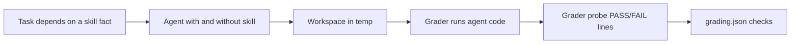

# Eval design

Skill evals live in `evals/<skill>/`, outside the skill directory, so installed skills do not carry them.
[evals/README.md](../evals/README.md) documents the runner, the task format, and the grader contract.
Related Lode files: [eval effort metrics](eval-effort-metrics.md) and [eval rubric](eval-rubric.md).

## Tasks

An eval task must depend on a skill fact that the agent cannot guess or check during a normal build. A cautious agent passed the first `fsharp-native-aot` tasks without the skill, so those tasks measured nothing.
A run with the skill counts only when the transcript shows that the agent loaded the skill.
Skill text must not contain the answer to its eval task. The `fsharp-verify-api` reference teaches the lookup, not a table of moved members. Its examples and proof script use packages that no eval task uses.
Eval workspaces live in the temp directory. A parent `global.json` above this repository pins SDK 8, and a parent `Directory.Packages.props` turns on central package management.

A task for a compiler-caught skill needs a library version whose API differs from the one that models remember. A task that shows lift needs an API released after the models' training data.
The `fsharp-verify-api` tasks do not meet that need yet. The evidence is one run for each target and mode, so it is weak:

- `cli-options` uses `System.CommandLine` 2.0.0. Claude Sonnet and Codex pass it without the skill. With the skill, they use more turns (15 against 9, and 22 against 17). Only opencode passes it with the skill and fails it without the skill.
- `order-props` uses FsCheck 3.4.0, whose F# API moved to `FsCheck.FSharp`. Claude Sonnet and Codex pass it without the skill. With the skill, they use more turns (13 against 6, and 16 against 12) and more failed builds (2 against 0, and 3 against 0).
- Both graders check that the package version did not change. An agent can otherwise downgrade to the version that it remembers.
- `evals/fsharp-verify-api/tests/Grader.Tests.ps1` runs both graders against committed good, old API, stub, and downgrade workspaces, and checks each check result by name.

## Graders

Graders run the agent's output, for example as a JIT build and as a native exe.
Graders run `dotnet` from the project directory because `dotnet` selects its SDK from the working directory.
Before you use a grader, test it against a known good result and a known bad result.
Text rules in graders reject valid alternatives, for example `and` type declarations or a `Result` return. Prefer checks that run the agent's code. Grade a result folder again with `evals/grade-evals.ps1` after a grader fix.

Graders for silent defects use fault injection. A grader probe loads the agent's script, calls its functions with failing input, and prints `PASS` or `FAIL` for each case. `ConvertFrom-ProbeOutput` in `evals/lib/Grading.psm1` turns each such line into one check. `Get-ProbeScript` adds `open X.X` to the probe when the agent's script declares `module X =`, because FSI then loads it as a nested module.
A grader that matches error text accepts any error shape: a string, a list, or a union. It checks that the printed error names the cause, for example the missing key.
A naive fix that wraps the result in `Result` but keeps the default, the catch-all handler, and `List.head errors` must fail the grader. Test the grader against that fix as well as against the original input and a known good result.

```powershell
$probe = Invoke-Capture dotnet @('fsi', 'Probe.fsx') -WorkingDirectory $dir
$results = @(ConvertFrom-ProbeOutput $probe.Lines)
$checks += New-Check 'Invoice.fsx and the probe compile together' ($probe.ExitCode -eq 0 -and $results.Count -gt 0)
$checks += $results
```

### Async semantics graders

Async semantics graders run the agent's code with a grader probe and fake dependencies. A cancellation grader checks that the inner work stops, not only that the task completes.
A ValueTask grader needs a pooled `IValueTaskSource` that resets on `GetResult`. A `Task`-backed `ValueTask` hides a second read.

### Nullness graders

The nullness eval graders build the agent's project with `Nullable=enable` and `TreatWarningsAsErrors=true` forced as global properties, read `Nullable`, `OtherFlags`, `TreatWarningsAsErrors`, `NoWarn`, `WarningsNotAsErrors`, `WarningLevel`, and `LangVersion` for `Release` with `dotnet msbuild -getProperty`, and run a driver with null inputs.
The settings check also requires every target framework to be `net10.0` or later, so a lower target cannot avoid the .NET 9 overloads. Nullness counts as on with `Nullable=enable` or `--checknulls+`, and as off when `OtherFlags` holds `--checknulls-`. A `--nowarn` for 3261 or 3262, or a global `--warnaserror-`, in `OtherFlags` counts as an exemption.
Settings with `--warn:0` to `--warn:2` or `WarningLevel` below 3 count as an exemption. A `LangVersion` below 9 counts as nullness off.
The driver project references the agent's project, so it sees only the public API. It turns nullness on and warnings as errors off. A nullness diagnostic in `Driver.fs` means the agent changed a signature, for example to `(string | null) option`.
A `nonNull`, `Unchecked.nonNull`, `NonNullQuick`, or `nullArgCheck` counts as a reasoned suppression only with a `//` comment (not `///`) or a `(* ... *)` comment on the same line or the line above. The check does not judge the reason. In `hidden-nulls`, `readLines` and `rootMessage` already behave correctly, so a commented `Unchecked.nonNull (reader.ReadLine())` passes every check. The text check also misses suppressions through a wrapper function, `Unchecked.defaultof`, `unbox`, or a downcast, because it cannot tell reference types from value types. `dotnet msbuild -getProperty` does not see properties set inside a `<Target>`, so an `OtherFlags` change such as `--checknulls-` in a target passes the settings check. The driver behavior checks are the main defense.
Driver output comparisons are case-sensitive. When the driver does not build, the behavior checks are skipped (`$null`), and the signature check carries the failure.

### Signature file grader

The `minimal-surface` and `add-signatures` tasks share one grader. It copies the original `Shop` and `Inventory.Tests` over the workspace copy, so an edited consumer or test cannot pass. The compile-order check covers only the three input files, so an extra `AssemblyInfo.fs` is valid. It writes `global.json` (SDK `10.0.100`, `latestFeature`) when the workspace has none.
It runs the skill's `public-surface.ps1` on the Release build and normalizes the output before it compares with `minimal-surface-expected.txt`. The `StockItem` constructor is optional (`minimal-surface-optional.txt`), because Shop and the tests only read `StockItem` values; the control probe gets a `StockItem` from `Stock.parseLine`. It removes compiler-generated `Equals`, `GetHashCode`, `CompareTo`, and `ToString` lines and the `IComparable`, `IEquatable`, and `IStructural*` interfaces, and it removes parameter names. An abstract type and a `private` representation then give the same surface, and a `val` without parameter names passes.
Probe consumers reference the agent's project. A control probe must build and run, or the four must-fail probes are skipped. A must-fail probe passes for any `error FS` in `Probe.fs`, because the code depends on the agent's choice: FS0039 for an abstract type, FS0800 when a union case has the type's name, and FS1093 for a `private` representation.
The grader reads FS3888 and FS0050 from the build output, because the build passes with these warnings.
The surface check cannot tell a member left out of the `.fsi` from a member marked `private` in the `.fs`.
`evals/fsharp-signature-files/tests/Grader.Tests.ps1` grades a known good result, the original input, raw `--allsigs` output, a public test-only helper, a `.fsi` after its `.fs`, docs only in the `.fs`, a missing `RequireQualifiedAccess`, a public `Sku` representation, an unlisted interface, a `private` representation with an extra `AssemblyInfo.fs` (must pass), a sealed `StockItem` class with an `internal` constructor (must pass), and a Shop that prints fixed text over a broken library.
The `minimal-surface` prompt names each graded requirement, and Claude Sonnet passed it without the skill (12/12 checks, 5 turns). The `add-signatures` prompt asks only for signature files that encapsulate the library, so it is the task that measures the skill. With 2 runs per mode, Claude Sonnet and Codex without the skill left the test-only `roundToCents` helper public (0/2 surface checks), and Codex also dropped the doc comments (0/2). With the skill, both passed 12/12 in each run, at the cost of more turns (7 against 4, and 14 against 10.5). opencode left `roundToCents` public in both modes. The full table is on issue #10.

### Settings grader

The `startup-settings` grader copies the workspace once for each settings file and runs `dotnet fsi App.fsx`. It writes its own `appsettings.json` for each run: valid, no `BlockedRegions` key, `FreeShippingOver` `0`, bad values with missing keys, out-of-range values (`MaxWeightKg` `0`, `RatePerKg` `0`, `FreeShippingOver` `-1`), and no `Shipping` section. The out-of-range run catches a parser that checks only that a key is present. The `0` run must print `ready` and quote 0.00 for each accepted order, so a parser that rejects `0` or reads `0` as a missing key fails. A run that prints `ready` counts as no startup failure, so validation at the first read fails the grader. The bad file omits `FreeShippingOver`, whose rule allows `0`, so only a `string` or `Nullable<decimal>` field, or a key check, reports it. The bad file has no number text that fails conversion. The skill binds numbers as `string` for that case, but the task rules do not name it, and a new scenario would need new runs.
It runs `ShippingTests.fsx` in a copy with no `appsettings.json`. The text checks remove `//` and `(* *)` comments first. `IValidateOptions` does not match the `IOptions` check.
`evals/fsharp-env-capabilities/tests/Grader.Tests.ps1` grades a known good result, the input with an `Options.Create` test, and seven edits of the good result. Each edit is a regex replacement that throws when it does not match. The edits are: no `IStartupValidator` call, only the first error printed, `FreeShippingOver` as `decimal`, a test that fails when `appsettings.json` exists, a parser that rejects `FreeShippingOver` `0`, a parser that accepts `MaxWeightKg` `0`, and a parser that skips the `RatePerKg` and `FreeShippingOver` range rules.
The grader deletes `appsettings.json` for the test run. A `[string]` parameter turns `$null` into an empty string, so the scenario parameter has no type.
Two rubric items ask whether the functions read a parsed type and whether they get it from the env. The prompt does not ask for an accessor, so the second item measures the skill's design, not a stated requirement.
Results with 2 runs per mode (full tables on issue #14). Codex ran the default model from `~/.codex/config.toml`.
- `claude:sonnet (claude-sonnet-5-5)` and `codex (gpt-6.1-sol, effort high; default from config, not recorded in run.json)` passed 100% with the skill. Without the skill, Sonnet kept `IOptions<ShippingSettings>` in `cost`, `check`, and `quote` and used `Options.Create` in the test (0/2). Codex passed every check without the skill, so the task shows no lift for Codex.
- No Claude or Codex baseline failed a binder-fact check: the missing `FreeShippingOver` key, the late `ValidateOnStart`, or the range runs. The Sonnet baselines read raw section values with `GetSection` and did not use the binder, so they never met the binder traps. The Sonnet lift comes from the design checks only: `Options.Create` in the test, `IOptions` in `Shipping.fsx`, and the `settings-capability` rubric item. The prompt says only "must not use the configuration system", so the check "uses no configuration or Options types" measures the skill's design, as the `settings-capability` item does.
- opencode used the free models `opencode/deepseek-v4.1-flash-free` and `opencode/glm-5.3-flash-free`. Three runs with the skill finished the task and passed every check. Every other free-model run gave no result. The shared OpenCode free quota ran out (`Free usage limit reached`), and `opencode run` waits without output until the runner stops it at 30 minutes. The runner then counts a with-skill run as not loaded and a baseline run as a failure, so a free-model baseline row of 0% is a quota stall, not a model result. Check the transcript size and the opencode log before you report such a row.
The `validated-type` question names the type that the binder fills, not the `[<CLIMutable>]` attribute. A `[<CLIMutable>]` record that only a validate function fills counts as `yes`.



See [practices](practices.md) for skill packaging and [terminology](terminology.md) for grader, grader probe, and fault injection.
