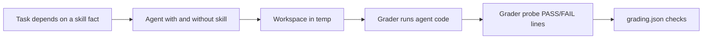

# Eval design

Skill evals live in `evals/<skill>/`, outside the skill directory, so installed skills do not carry them.
[evals/README.md](../evals/README.md) documents the runner, the task format, and the grader contract.
Related Lode files: [eval effort metrics](eval-effort-metrics.md) and [eval rubric](eval-rubric.md).

## Tasks

An eval task must depend on a skill fact that the agent cannot guess or check during a normal build. A cautious agent passed the first `fsharp-native-aot` tasks without the skill, so those tasks measured nothing.
A run with the skill counts only when the transcript shows that the agent loaded the skill.
Skill text must not contain the answer to its eval task. The `fsharp-verify-api` reference teaches the lookup, not a table of moved members. Its examples and proof script use packages that no eval task uses.
Eval workspaces live in the temp directory. A parent `global.json` above this repository pins SDK 8, and a parent `Directory.Packages.props` turns on central package management.

A task for a compiler-caught skill needs a library version whose API differs from the one that models remember. A task that shows lift needs an API released after the models' training data.
The `fsharp-verify-api` tasks do not meet that need yet. The evidence is one run for each target and mode, so it is weak:

- `cli-options` uses `System.CommandLine` 2.0.0. Claude Sonnet and Codex pass it without the skill. With the skill, they use more turns (15 against 9, and 22 against 17). Only opencode passes it with the skill and fails it without the skill.
- `order-props` uses FsCheck 3.4.0, whose F# API moved to `FsCheck.FSharp`. Claude Sonnet and Codex pass it without the skill. With the skill, they use more turns (13 against 6, and 16 against 12) and more failed builds (2 against 0, and 3 against 0).
- Both graders check that the package version did not change. An agent can otherwise downgrade to the version that it remembers.
- `evals/fsharp-verify-api/tests/Grader.Tests.ps1` runs both graders against committed good, old API, stub, and downgrade workspaces, and checks each check result by name.

## Graders

Graders run the agent's output, for example as a JIT build and as a native exe.
Graders run `dotnet` from the project directory because `dotnet` selects its SDK from the working directory.
Before you use a grader, test it against a known good result and a known bad result.
Text rules in graders reject valid alternatives, for example `and` type declarations or a `Result` return. Prefer checks that run the agent's code. Grade a result folder again with `evals/grade-evals.ps1` after a grader fix.

Graders for silent defects use fault injection. A grader probe loads the agent's script, calls its functions with failing input, and prints `PASS` or `FAIL` for each case. `ConvertFrom-ProbeOutput` in `evals/lib/Grading.psm1` turns each such line into one check. `Get-ProbeScript` adds `open X.X` to the probe when the agent's script declares `module X =`, because FSI then loads it as a nested module.
A grader that matches error text accepts any error shape: a string, a list, or a union. It checks that the printed error names the cause, for example the missing key.
A naive fix that wraps the result in `Result` but keeps the default, the catch-all handler, and `List.head errors` must fail the grader. Test the grader against that fix as well as against the original input and a known good result.

```powershell
$probe = Invoke-Capture dotnet @('fsi', 'Probe.fsx') -WorkingDirectory $dir
$results = @(ConvertFrom-ProbeOutput $probe.Lines)
$checks += New-Check 'Invoice.fsx and the probe compile together' ($probe.ExitCode -eq 0 -and $results.Count -gt 0)
$checks += $results
```

### Async semantics graders

Async semantics graders run the agent's code with a grader probe and fake dependencies. A cancellation grader checks that the inner work stops, not only that the task completes.
A ValueTask grader needs a pooled `IValueTaskSource` that resets on `GetResult`. A `Task`-backed `ValueTask` hides a second read.

### Nullness graders

The nullness eval graders build the agent's project with `Nullable=enable` and `TreatWarningsAsErrors=true` forced as global properties, read `Nullable`, `OtherFlags`, `TreatWarningsAsErrors`, `NoWarn`, `WarningsNotAsErrors`, `WarningLevel`, and `LangVersion` for `Release` with `dotnet msbuild -getProperty`, and run a driver with null inputs.
The settings check also requires every target framework to be `net10.0` or later, so a lower target cannot avoid the .NET 9 overloads. Nullness counts as on with `Nullable=enable` or `--checknulls+`, and as off when `OtherFlags` holds `--checknulls-`. A `--nowarn` for 3261 or 3262, or a global `--warnaserror-`, in `OtherFlags` counts as an exemption.
Settings with `--warn:0` to `--warn:2` or `WarningLevel` below 3 count as an exemption. A `LangVersion` below 9 counts as nullness off.
The driver project references the agent's project, so it sees only the public API. It turns nullness on and warnings as errors off. A nullness diagnostic in `Driver.fs` means the agent changed a signature, for example to `(string | null) option`.
A `nonNull`, `Unchecked.nonNull`, `NonNullQuick`, or `nullArgCheck` counts as a reasoned suppression only with a `//` comment (not `///`) or a `(* ... *)` comment on the same line or the line above. The check does not judge the reason. In `hidden-nulls`, `readLines` and `rootMessage` already behave correctly, so a commented `Unchecked.nonNull (reader.ReadLine())` passes every check. The text check also misses suppressions through a wrapper function, `Unchecked.defaultof`, `unbox`, or a downcast, because it cannot tell reference types from value types. `dotnet msbuild -getProperty` does not see properties set inside a `<Target>`, so an `OtherFlags` change such as `--checknulls-` in a target passes the settings check. The driver behavior checks are the main defense.
Driver output comparisons are case-sensitive. When the driver does not build, the behavior checks are skipped (`$null`), and the signature check carries the failure.



See [practices](practices.md) for skill packaging and [terminology](terminology.md) for grader, grader probe, and fault injection.
