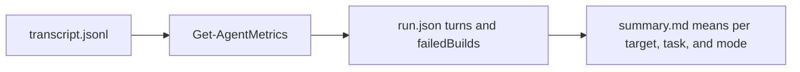

# Eval effort metrics

Pass rate does not measure skills for compiler-caught problems such as FS0039 and FS0078. The agent still finishes, but after many failed builds.
So each `run.json` records `turns` and `failedBuilds`, and the summary shows their means for each target, task, and mode.
The definitions and the parse rules for each agent are in [evals/README.md "Effort metrics"](../evals/README.md#effort-metrics). This file keeps the reasons and the lessons.

## Contract

- `Get-AgentMetrics` in `evals/lib/Agents.psm1` parses both values from the Claude Code, Codex, and opencode transcript formats.
- Each agent counts turns differently, so compare turns only between modes of one target.
- `evals/grade-evals.ps1` keeps the values in each `run.json`. It reads them from `transcript.jsonl` when a `run.json` does not have them.
- A dry run parses no metrics. The README states this limit and gives a real run with known values.
- `evals/tests/Metrics.Tests.ps1` checks the parser and the summary against small transcript fixtures in `evals/tests/fixtures/`.

## Lessons

- The `failedBuilds` metric counts each non-zero `dotnet run`. A CLI task that tests error exits with `dotnet run` adds failed builds that are not compiler errors.
- A lookup that a skill recommends must exit 0 when a member is missing. The runner counts each non-zero `dotnet fsi` call as a failed build.

```powershell
Import-Module ./evals/lib/Agents.psm1
Get-AgentMetrics -Agent opencode -TranscriptPath <run>/transcript.jsonl -Skill fsharp-iwsam-errors |
    Select-Object Turns, FailedBuilds
```



See [eval design](eval-design.md) for task design and [terminology](terminology.md) for turn and failed build call.
