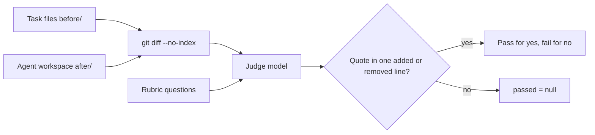

# Eval rubric

A task can declare `rubric` items (`id`, `question`) for problems that builds and tests do not show: non-idiomatic shape, speculative code, and missed reuse.
The full rubric contract is in [evals/README.md "Rubric checks"](../evals/README.md#rubric-checks): what the judge sees, the diff options, the quote rule, the skip rules, the judge command, and the agreement results. Do not copy the contract here. This file keeps the design reasons and lessons.

```json
"rubric": [{ "id": "direct-composition", "question": "Does placeOrder call each leaf function directly, with no Result.mapError?" }]
```

## Invariants

- The judge must not see the mode or the skill text. A judge that sees the skill can grade the skill, not the code.
- A judge answer counts only with a quote from one added or removed diff line. An unchanged context line is not evidence of what the agent did. A removed line stays valid, so an item can ask about code that the agent removed.
- A skipped check (`passed = null`) is not a pass and not a failure. The other checks of the grader stay.
- The summary pairs checks by text, so a reworded question needs a regrade of old results with `evals/grade-evals.ps1`.

## Design lessons

- A rubric task for idiomatic shape must leave the shape open. The `fsharp-idiom-review` task `port-order-report` asks for a port of a C# class and fixes only the function names (camelCase of the C# methods) and `render : Order -> string`. The prompt does not say "idiomatic" and does not name records or options. A line-by-line port then keeps the C# shape: a tuple, a `bool * value` pair, an `if`/`elif` chain, mutable accumulators, and a list index.
- Its grader probe checks behavior only through `render`, so any inner shape passes the probe. Each rubric item is also a checklist item in the skill.
- Ambiguous rubric wording is the main cause of different answers between grades. Grade the same workspaces two or more times before you trust a rubric.
- `evals/tests/Rubric.Tests.ps1` tests `Invoke-Rubric` with a fake judge. It does not call a model.



See [eval design](eval-design.md) for grader design and [terminology](terminology.md) for rubric and judge.
