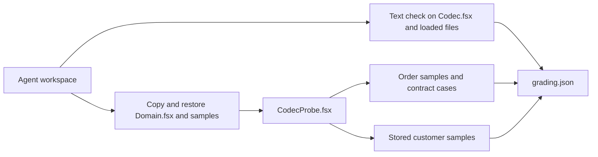

# Serialization eval

The `fsharp-serialization` eval has one task, `billing-codec`. General eval rules are in [eval design](eval-design.md). The proof runner contract is in [proof runners](proof-runners.md).

## Task

The workspace holds `Domain.fsx`, `Codec.fsx`, `CONTRACT.md`, three billing order samples, and two stored customer samples.
`Codec.fsx` uses one `JsonFSharpOptions.Default()` options value for customers and orders. The agent must change the order codec to follow `CONTRACT.md` and keep the customer JSON unchanged.

The contract needs these settings at the same time:

- An internal `kind` tag with snake_case tag names for `Payment`, and plain strings for `OrderStatus`. `Cash` must stay an object, so `WithUnionUnwrapFieldlessTags` needs a `WithOverrides` entry for `Payment`.
- camelCase property names for orders, and the default PascalCase `{"Case":...}` shape for customers. One global options value cannot give both.
- `Map<int, int>` as an object (`MapFormat.Object`).
- Optional values left out on write, and absent or `null` read as `None`. Of the settings that the proof script compares, only `WithSkippableOptionFields(SkippableOptionFields.Always, deserializeNullAsNone = true)` does this and keeps required fields required.

```fsharp
let orderOptions =
    JsonFSharpOptions
        .Default()
        .WithUnionInternalTag()
        .WithUnionNamedFields()
        .WithUnionTagName("kind")
        .WithUnionTagNamingPolicy(JsonNamingPolicy.SnakeCaseLower)
        .WithUnionUnwrapFieldlessTags()
        .WithSkippableOptionFields(SkippableOptionFields.Always, deserializeNullAsNone = true)
        .WithMapFormat(MapFormat.Object)
        .WithOverrides(fun o -> dict [ typeof<Payment>, o.WithUnionUnwrapFieldlessTags(false) ])
        .ToJsonSerializerOptions(PropertyNamingPolicy = JsonNamingPolicy.CamelCase)
```

## Overlap with the skill

The skill teaches each setting that the task needs, because these settings are the subject of the skill. The skill does not contain the task's options value.
Its examples use the `type` tag name, the `CamelCase` and `KebabCaseLower` tag policies, and the `Shape`, `Level`, and `Reading` types. The task uses the `kind` tag name, the `SnakeCaseLower` tag policy, and the `Order` types.
The agent must still map each contract rule to a setting, keep the customer shape, and find the `null` option case.

## Why the prompt forbids a hand-written parser

The first version of the task asked for a new `Codec.fsx` with no starting code. Claude Sonnet and Codex wrote a `JsonElement` parser by hand without the skill and passed every check (7 and 10 turns). A hand-written parser avoids every converter setting, so the task measured nothing.
The current prompt says to use `JsonSerializer` with FSharp.SystemTextJson, and not to read or write JSON with `JsonDocument`, `JsonNode`, `JsonElement`, `Utf8JsonReader`, `Utf8JsonWriter`, or a custom `JsonConverter`.
The text check reads only `Codec.fsx` and the files that it loads with `#load`, except `Domain.fsx`. It reads `#load` lines, character literals, strings, and comments in one scan, so a `'"'` literal does not start a string. It keeps each `#load` directive and its quoted or verbatim (`@"..."`) paths when they are outside a string or comment, and removes comments and string contents. A trailing comment on a `#load` line is removed like any other comment. The type-name match does not read `#load` lines, so a file name such as `JsonNode.fsx` does not fail the check. A `#load` inside a comment or a multiline string does not add a file, and inline JSON that contains `JsonNode` does not fail the check. A test file that uses `JsonNode.DeepEquals`, as the skill recommends, does not fail the check. A DTO with `JsonSerializer` passes.

## Grader

`graders/billing-codec.ps1` copies the workspace, restores the original `Domain.fsx` and samples, writes its own `global.json`, and runs `graders/CodecProbe.fsx` with `dotnet fsi`.
The probe opens `Codec` before `Domain` and gives each expected value a type annotation, so a DTO record with the domain labels cannot capture the probe's record literals.
The probe compares decoded values with F# values, and compares encoded JSON with each sample through `JsonNode.DeepEquals`. Property order is ignored, numbers compare by value, and a `null` property differs from an absent property.
The probe calls the agent's functions inside `try`, so a thrown exception fails the check and does not stop the probe. A `NullReferenceException` from `WhenWritingNull` with a missing `int` is one such case.



`tests/Grader.Tests.ps1` grades these results and checks each check by name:

| Case | Failing checks |
| --- | --- |
| Known good, `module Codec =` copy, DTO layer, a test file, comments, and strings that name `JsonNode` or `#load` it | None |
| DTO that rejects unknown line properties | Unknown properties in a line and in the payment |
| Original input | Every order sample check, `null` optional values, unknown nested properties, and `Case`/`Fields` |
| No `Codec.fsx` | The compile check |
| Edited `Domain.fsx` | `Domain.fsx is unchanged` |
| `JsonObject` in the codec, `JsonDocument` in a file loaded with a normal or a verbatim path | The text check |
| One options value for customers and orders | The four customer checks |
| `WhenWritingNull` | Missing `id` and `reserved` (read as `null`) and a line without `quantity` (throws `NullReferenceException`) |
| DTO that reads a missing `reserved` as empty | Missing and `null` `reserved` |
| `decodeCustomer` that returns `Result<Customer, exn>` | The compile check |
| `WithSkippableOptionFields()` | `null` note (reads as `Some null`) and `null` discount (throws) |

The text check does not find a parser that reads JSON with string functions or regular expressions.
The comment removal does not nest `(* *)` comments, so a nested comment can hide a type name from the check or show one to it.
The prompt names `JsonNode` but not its subtypes `JsonObject`, `JsonArray`, and `JsonValue`. The text check rejects all four.
The `checkError` cases do not cover a missing `status`, `payment`, or `sku`.

## Eval results on issue 12

The runs used explicit invocation and the final grader (`grade-evals.ps1`). Each run with the skill loaded it. opencode used free models, as the maintainer asked.

| Target | Mode | Counted runs | Pass rate | Turns | Failed builds |
| --- | --- | --- | --- | --- | --- |
| claude:sonnet (claude-sonnet-5-5) | with | 2 | 100% | 8.5 | 0.0 |
| claude:sonnet (claude-sonnet-5-5) | without | 2 | 91% | 18.5 | 2.0 |
| codex (gpt-6.1-sol, effort high; default from config, not recorded in run.json) | with | 2 | 100% | 16.0 | 0.0 |
| codex (gpt-6.1-sol, effort high; default from config, not recorded in run.json) | without | 2 | 100% | 20.5 | 1.5 |
| opencode:opencode/deepseek-v4.1-flash-free | with | 2 | 100% | 25.0 | 5.5 |
| opencode:opencode/deepseek-v4.1-flash-free | without | 1 | 100% | 29.0 | 11.0 |
| opencode:opencode/glm-5.3-flash-free | with | 0 | - | - | - |
| opencode:opencode/glm-5.3-flash-free | without | 0 | - | - | - |

Models: `claude:sonnet` ran `claude-sonnet-5-5`, read from the `model` field of each transcript. The plain `codex` target ran the Codex default from `~/.codex/config.toml` (`gpt-6.1-sol`, `model_reasoning_effort = "high"`). `run.json` records an empty model for it. The opencode targets ran `deepseek-v4.1-flash-free` and `glm-5.3-flash-free` from the `opencode` provider. The opencode log confirms the deepseek model for each of the four deepseek sessions. The blocked glm run started no session.

- Claude Sonnet without the skill used `WhenWritingNull` in both runs. A missing `id` then decoded as `Ok` with `Id = null`, and a line without `quantity` threw. In one run, a missing `reserved` also decoded as `Ok` with `Reserved = null`. With the skill, both runs used `deserializeNullAsNone = true`.
- In one earlier baseline run, Claude Sonnet without the skill used `WithSkippableOptionFields(SkippableOptionFields.Always)` and failed both `null` option checks.
- Codex and deepseek used `deserializeNullAsNone = true` and `WithOverrides` in both modes. The skill reduced turns and failed builds for these targets, but not the pass rate.
- The free opencode models hit the account limit "Free usage limit reached". `opencode run` then retries with no output until the 30-minute limit. The second deepseek run without the skill stopped after 4 turns with `Codec.fsx` unchanged (17/27 checks). The first glm run with the skill produced an empty transcript. These runs measure the quota, not the model, so the table does not count them. The other glm runs did not start. Issue #23 covers the retry of the free-model runs.
- The Claude Sonnet and Codex runs used the skill before the PR review fixes. The opencode runs used the final skill. The fixes changed reference text and proof checks, not the rules.

```powershell
pwsh ./evals/run-evals.ps1 -Skill fsharp-serialization -Target claude:sonnet,codex,opencode:opencode/deepseek-v4.1-flash-free,opencode:opencode/glm-5.3-flash-free -Runs 2
```
