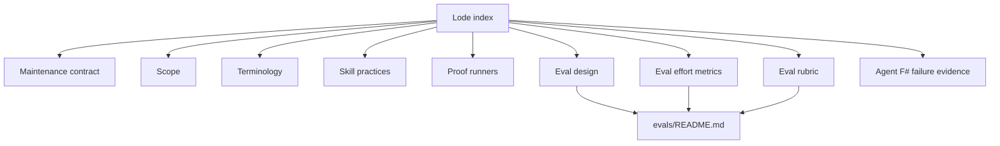

# Lode index

- [readme.md](readme.md): purpose, session entry, and maintenance contract.
- [summary.md](summary.md): repository scope.
- [terminology.md](terminology.md): shared terms.
- [practices.md](practices.md): skill packaging, catalog, and proof script rules.
- [proof-runners.md](proof-runners.md): the contract of each skill's proof runner.
- [eval-design.md](eval-design.md): eval task and grader design.
- [eval-effort-metrics.md](eval-effort-metrics.md): turns and failed builds, with reasons and lessons.
- [eval-rubric.md](eval-rubric.md): rubric invariants and design lessons.
- [agent-fsharp-failures.md](agent-fsharp-failures.md): ranked evidence of agent F# failures and the skill for each area.
- [evals/README.md](../evals/README.md): eval runner usage, grader contract, effort metric rules, and rubric contract (outside the Lode).
- `plans/`: roadmaps and open work.
- `tmp/`: ignored session notes and handovers.

Keep this index aligned with persistent documents so agents can find the applicable guidance before searching source files.

```powershell
Get-Content lode/practices.md
```


