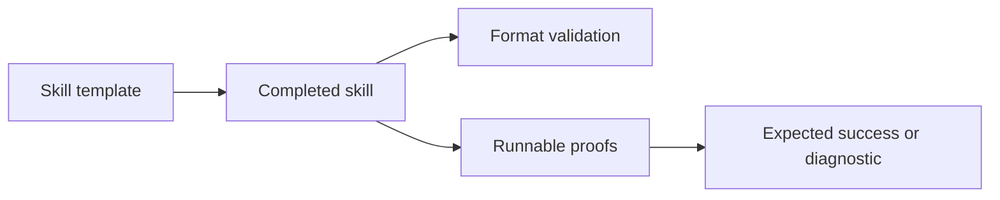

# Skill packaging

This file covers how to package, verify, and publish a skill. Related Lode files:

- [proof-runners.md](proof-runners.md): the contract of each skill's proof runner.
- [eval-design.md](eval-design.md): eval tasks and graders.
- [eval-effort-metrics.md](eval-effort-metrics.md): turns and failed builds.
- [eval-rubric.md](eval-rubric.md): rubric design lessons.

## Format

Use [skills/README.md](../skills/README.md) and the [Agent Skills specification](https://agentskills.io/specification) when creating skills.
The template is a starting point. Replace its placeholders before distributing a skill.
The frontmatter `name` must match the skill directory name.

The `skills/<skill-name>/SKILL.md` layout supports discovery by the [skills CLI](https://github.com/vercel-labs/skills).
No npm package manifest is required. GitHub installation uses the published files, not uncommitted local skills.

Keep general .NET reliability skills in [dotnet-reliability-skills](https://github.com/TheAngryByrd/dotnet-reliability-skills).
Link that collection from the repository README instead of duplicating its generator-review and mutation-testing guidance.
The parsing and type-check graph skills are self-contained guidance. They do not include proof runners.

Check local discovery from the repository root:

```sh
npx skills add . --list
```

Before publishing packaging changes, install the selected skills from an absolute local path into a temporary project.
Compare the installed entry points and supporting files with their source files.

## Catalog

The [repository README](../readme.md) is the user-facing skill catalog.
Update it with every skill addition, change, rename, or removal.
Keep each skill's purpose, reason for use, usage instructions, prerequisites, and links aligned with its files.
Document verification commands separately from verified results so instructions do not imply successful execution.

## Proof scripts

Bundle relevant proof scripts under each skill's `scripts/` directory. Use relative paths and document prerequisites.
Local machine paths do not provide portable evidence. Public files must exclude private content.
For compile-time break tests, check the expected diagnostic as well as compilation failure. An unrelated compiler failure is not proof.
Proof runners reject unexpected compiler errors. The FSI runners with compile-time break tests (`fsharp-iwsam-errors` and `fsharp-env-capabilities`) also preserve the complete inferred signatures for inspection. [proof-runners.md](proof-runners.md) gives what each other runner checks.
The runners require PowerShell 7.2 or later so redirected native stderr does not terminate expected compiler-failure checks.
Successful example execution does not assert the printed runtime outcomes. Compare those outcomes with each skill's findings document. The runners that do assert outcomes are listed in [proof-runners.md](proof-runners.md).

Example format check, when `skills-ref` is installed:

```powershell
skills-ref validate ./skills/<skill-name>
```

This command checks the format. Run the bundled proof scripts separately to verify behavior.



See [terminology](terminology.md) for the meaning of proof scripts and compile-time break tests.
See [readme.md](readme.md) for the project knowledge maintenance contract.
