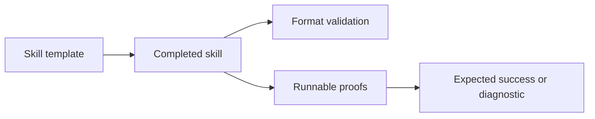

# Skill packaging

Use [skills/README.md](../skills/README.md) and the [Agent Skills specification](https://agentskills.io/specification) when creating skills.
The template is a starting point. Replace its placeholders before distributing a skill.
The frontmatter `name` must match the skill directory name.

The `skills/<skill-name>/SKILL.md` layout supports discovery by the [skills CLI](https://github.com/vercel-labs/skills).
No npm package manifest is required. GitHub installation uses the published files, not uncommitted local skills.

Keep general .NET reliability skills in [dotnet-reliability-skills](https://github.com/TheAngryByrd/dotnet-reliability-skills).
Link that collection from the repository README instead of duplicating its generator-review and mutation-testing guidance.
The parsing and type-check graph skills are self-contained guidance. They do not include proof runners.

The IWSAM and environment proof runners use a `scripts/global.json` with SDK `10.0.100` and `latestFeature` roll-forward.
The runners select their script directory before invoking `dotnet`, so a parent SDK pin does not select F# 8.
F# 8 can report `FS0192` on the IWSAM examples. Preserve the SDK file when packaging these skills.
The examples use `FsToolkit.ErrorHandling` 5.2.0 for `result`, `validation`, and `taskResult`.
Do not add the obsolete `FsToolkit.ErrorHandling.TaskResult` package.

The nullness proof runner is project-based because nullness checks and `TreatWarningsAsErrors` are project properties.
It builds `scripts/Clean` and compares its printed null results. Each `scripts/breaks/*.fs` file is copied into its own temp project from `Break.fsproj.txt` and must fail with exactly the codes in its `// expect:` lines, and its output must contain each `// expect-text:` message.
The nullness eval graders build the agent's project with `Nullable=enable` and `TreatWarningsAsErrors=true` forced as global properties, read `Nullable`, `OtherFlags`, `TreatWarningsAsErrors`, `NoWarn`, `WarningsNotAsErrors`, `WarningLevel`, and `LangVersion` for `Release` with `dotnet msbuild -getProperty`, and run a driver with null inputs.
The settings check also requires every target framework to be `net10.0` or later, so a lower target cannot avoid the .NET 9 overloads. Nullness counts as on with `Nullable=enable` or `--checknulls+`, and as off when `OtherFlags` holds `--checknulls-`. A `--nowarn` for 3261 or 3262, or a global `--warnaserror-`, in `OtherFlags` counts as an exemption.
The driver project references the agent's project, so it sees only the public API. It turns nullness on and warnings as errors off. A nullness diagnostic in `Driver.fs` means the agent changed a signature, for example to `(string | null) option`.
A `nonNull`, `Unchecked.nonNull`, `NonNullQuick`, or `nullArgCheck` counts as a reasoned suppression only with a `//` comment (not `///`) or a `(* ... *)` comment on the same line or the line above. The check does not judge the reason. In `hidden-nulls`, `readLines` and `rootMessage` already behave correctly, so a commented `Unchecked.nonNull (reader.ReadLine())` passes every check. The text check also misses suppressions through a wrapper function, `Unchecked.defaultof`, `unbox`, or a downcast, because it cannot tell reference types from value types. `dotnet msbuild -getProperty` does not see properties set inside a `<Target>`, so an `OtherFlags` change such as `--checknulls-` in a target passes the settings check. The driver behavior checks are the main defense.
Settings with `--warn:0` to `--warn:2` or `WarningLevel` below 3 count as an exemption. A `LangVersion` below 9 counts as nullness off.
The proof runner sets `FSHARP_NULLNESS_PROOF_ROOT` to a per-run temp directory. `scripts/Directory.Build.props` puts `bin` and `obj` there, and the runner deletes it. Driver output comparisons are case-sensitive. When the driver does not build, the behavior checks are skipped (`$null`), and the signature check carries the failure.

The Native AOT proof runner is project-based because `dotnet fsi` cannot publish a native exe.
Its `scripts/` directory holds `Directory.Build.props`, `Directory.Build.targets`, and `Directory.Packages.props`.
These files stop parent MSBuild files, such as central package management, from changing the proof.
`Directory.Build.props` sends `bin` and `obj` to the system temp directory, so an installed skill contains no build output.
The runner compares each probe's JIT and native results with an expected verdict: `same`, `throws`, or `differs`.
Each metadata fix needs its own small exe. A fix in a shared exe keeps metadata for every probe in that exe.

The async composition proof runner runs `Proofs.fsx` with FSI and builds a `StateMachine` project in Release.
FSI does not report FS3511, so the state machine check needs a Release project build.
The runner reuses the Native AOT isolation files with its own temp artifact folder.
Write each `do!` and `return` on its own line in proof scripts. A one-line `async { do! x; return y }` gives FS0748.

Async semantics graders run the agent's code with a grader probe and fake dependencies. A cancellation grader checks that the inner work stops, not only that the task completes.
A ValueTask grader needs a pooled `IValueTaskSource` that resets on `GetResult`. A `Task`-backed `ValueTask` hides a second read.

Skill evals live in `evals/<skill>/`, outside the skill directory, so installed skills do not carry them.
[evals/README.md](../evals/README.md) documents the runner, the task format, and the grader contract.
An eval task must depend on a skill fact that the agent cannot guess or check during a normal build. A cautious agent passed the first `fsharp-native-aot` tasks without the skill, so those tasks measured nothing.
Graders run the agent's output, for example as a JIT build and as a native exe.
Before you use a grader, test it against a known good result and a known bad result.
Text rules in graders reject valid alternatives, for example `and` type declarations or a `Result` return. Prefer checks that run the agent's code. Grade a result folder again with `evals/grade-evals.ps1` after a grader fix.
Graders for silent defects use fault injection. The `parse-dont-validate` and `fsharp-failure-paths` graders load the agent's script into a grader probe that calls its functions with failing input and prints `PASS` or `FAIL` for each case.
A grader that matches error text accepts any error shape: a string, a list, or a union. It checks that the printed error names the cause, for example the missing key.
A naive fix that wraps the result in `Result` but keeps the default, the catch-all handler, and `List.head errors` must fail the grader. Test the grader against that fix as well as against the original input and a known good result.
Eval workspaces live in the temp directory. A parent `global.json` above this repository pins SDK 8, and a parent `Directory.Packages.props` turns on central package management.
Graders run `dotnet` from the project directory because `dotnet` selects its SDK from the working directory.
A run with the skill counts only when the transcript shows that the agent loaded the skill.
Pass rate does not measure skills for compiler-caught problems such as FS0039 and FS0078. The agent still finishes, but after many failed builds.
So each `run.json` records `turns` and `failedBuilds`, and the summary shows their means for each target, task, and mode.
`Get-AgentMetrics` in `evals/lib/Agents.psm1` parses them from all three transcript formats. Each agent counts turns differently, so compare turns only within one target.
`evals/tests/Metrics.Tests.ps1` checks the parser and the summary against small transcript fixtures in `evals/tests/fixtures/`.
A task for a compiler-caught skill needs a library version whose API differs from the one that models remember. The `fsharp-verify-api` `cli-options` task uses `System.CommandLine` 2.0.0. Claude Sonnet and Codex already knew that API and passed without the skill. The `order-props` task uses FsCheck 3.4.0, whose F# API moved to `FsCheck.FSharp`. Claude Sonnet and Codex also knew that API. In one run each, the skill added turns for them and helped only opencode on `cli-options`. A task that shows lift needs an API released after the models' training data.
Its grader also checks that the package version did not change. An agent can otherwise downgrade to the version that it remembers.
Skill text must not contain the answer to its eval task. The `fsharp-verify-api` reference teaches the lookup, not a table of moved members. Its examples and proof script use packages that no eval task uses.
A lookup that the skill recommends must exit 0 when a member is missing. The runner counts each non-zero `dotnet fsi` call as a failed build.
`evals/fsharp-verify-api/tests/Grader.Tests.ps1` runs both graders against committed good, old API, stub, and downgrade workspaces, and checks each check result by name.
The `failedBuilds` metric counts each non-zero `dotnet run`. A CLI task that tests error exits with `dotnet run` adds failed builds that are not compiler errors.

A task can declare `rubric` items (`id`, `question`) for problems that builds and tests do not show: non-idiomatic shape, speculative code, and missed reuse.
The task grader calls `Invoke-Rubric` from `evals/lib/Grading.psm1`, which returns one three-state check for each item.
The judge sees only the questions and a `git diff --no-index --ignore-cr-at-eol` of the task inputs (`before/`) against the workspace (`after/`), without `TASK.md` or skill folders. It must not see the mode or the skill text.
The diff replaces the install name `<skill>-eval` with `<skill>`. Text that the agent writes about a skill can still reach the judge.
A judge answer counts only with a quote of 4 or more characters inside one hunk code line (added, removed, or unchanged). Headers, `@@` lines, and quotes on more than one line do not count.
A missing or invented quote, a malformed judge reply, a judge failure, an invalid `SKILL_EVAL_JUDGE`, or a missing `git` gives `passed = null`. A rubric item without an `id` or a `question` skips all items of the task. After `Invoke-Rubric` reads `evals.json`, it does not throw, so the other checks of the grader stay. A malformed `evals.json` still throws.
The diff uses `--no-ext-diff` and `--no-textconv`, because an external diff tool in the user's git config writes no hunks.
The check text is `Rubric <id>: <question>`. The summary pairs checks by text, so a reworded question needs a regrade of old results.
Native output is decoded as UTF-8 for the diff and the judge. The Windows console code page otherwise garbles non-ASCII code, and the quotes then do not match.
The judge command is the JSON array in `SKILL_EVAL_JUDGE` (`off` skips). The default is `claude -p --model haiku` with no tools, no setting sources, and its own `--system-prompt`, run in an empty temp directory. Without `--system-prompt`, the judge receives the user's instructions.
A rubric task for idiomatic shape must leave the shape open. The `fsharp-idiom-review` task `port-order-report` asks for a port of a C# class and fixes only the function names (camelCase of the C# methods) and `render : Order -> string`. The prompt does not say "idiomatic" and does not name records or options. A line-by-line port then keeps the C# shape: a tuple, a `bool * value` pair, an `if`/`elif` chain, mutable accumulators, and a list index.
Its grader probe checks behavior only through `render`, so any inner shape passes the probe. Each rubric item is also a checklist item in the skill.
Ambiguous rubric wording is the main cause of different answers between grades. Grade the same workspaces two or more times before you trust a rubric. `evals/tests/Rubric.Tests.ps1` tests the function with a fake judge.

```json
"rubric": [{ "id": "direct-composition", "question": "Does placeOrder call each leaf function directly, with no Result.mapError?" }]
```

Check local discovery from the repository root:

```sh
npx skills add . --list
```

Before publishing packaging changes, install the selected skills from an absolute local path into a temporary project.
Compare the installed entry points and supporting files with their source files.

The [repository README](../readme.md) is the user-facing skill catalog.
Update it with every skill addition, change, rename, or removal.
Keep each skill's purpose, reason for use, usage instructions, prerequisites, and links aligned with its files.
Document verification commands separately from verified results so instructions do not imply successful execution.

Bundle relevant proof scripts under each skill's `scripts/` directory. Use relative paths and document prerequisites.
Local machine paths do not provide portable evidence. Public files must exclude private content.
For compile-time break tests, check the expected diagnostic as well as compilation failure. An unrelated compiler failure is not proof.
Proof runners reject unexpected compiler errors and preserve the complete inferred signatures for inspection.
The runners require PowerShell 7.2 or later so redirected native stderr does not terminate expected compiler-failure checks.
Successful example execution does not assert the printed runtime outcomes. Compare those outcomes with each skill's findings document.
The `fsharp-failure-paths` and `fsharp-async-composition` proof runners are exceptions. `FailurePaths.fsx` compares each outcome with an expected value and exits with code 1 on a mismatch. The failure-path runner has no compile-time break tests and prints no inferred signatures.
The async composition runner checks each outcome in `Proofs.fsx` and fails on a mismatch. It also checks that `StartCrash.fsx` stops the process and that the FS3511 warning occurs only in `Dynamic.fs`. The async runner has no compile-time break tests and prints no inferred signatures.
The idiom review runner checks that each before form in `Idioms.fsx` gives the same result as its after form, and that `static member X = expr` runs `expr` on each access.
The `fsharp-verify-api` runner also asserts: it lists Expecto 10 and 11, `FSharp.Core`, and extension members through `scripts/show-api.ps1` and fails when an expected member is missing or a removed member is present.
`ShowApi.fsx` prints F# source names from `CompilationSourceNameAttribute`, so `ListModule.TryHead` shows as `tryHead`. It also lists extension methods whose first parameter is the type or one of its bases.
`show-api.ps1` writes a temporary `.fsx` with a pinned `#r "nuget: ..."` line and runs it from `scripts/`, so `scripts/global.json` selects the SDK.
 
Example format check, when `skills-ref` is installed:

```powershell
skills-ref validate ./skills/<skill-name>
```

This command checks the format. Run the bundled proof scripts separately to verify behavior.



See [terminology](terminology.md) for the meaning of proof scripts and compile-time break tests.
See [readme.md](readme.md) for the project knowledge maintenance contract.
