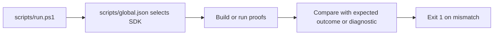

# Proof runners

Each skill with a proof runner keeps it under `skills/<skill>/scripts/`. The general proof rules are in [practices](practices.md). This file records the contract of each runner.

## IWSAM and environment capabilities

These runners run each proof script with `dotnet fsi` and print the inferred signatures of the main functions for inspection. Each `scripts/breaks/*.fsx` file must fail with its one expected FS code.

The IWSAM and environment proof runners use a `scripts/global.json` with SDK `10.0.100` and `latestFeature` roll-forward.
The runners select their script directory before invoking `dotnet`, so a parent SDK pin does not select F# 8.
F# 8 can report `FS0192` on the IWSAM examples. Preserve the SDK file when packaging these skills.
The examples use `FsToolkit.ErrorHandling` 5.2.0 for `result`, `validation`, and `taskResult`.
Do not add the obsolete `FsToolkit.ErrorHandling.TaskResult` package.

The environment runner also runs `Settings.fsx`, which asserts its outcomes and exits with code 1 on a mismatch. It checks configuration binder results for F# types, `Result` parsing that reports every error, and startup validation. `ValidateOnStart` with no host does not run, so the script calls `IStartupValidator.Validate()`:

```fsharp
let start (provider: IServiceProvider) =
    provider.GetRequiredService<IStartupValidator>().Validate()
    provider.GetRequiredService<IAppEnvironment>()
```

## Nullness interop

The nullness proof runner is project-based because nullness checks and `TreatWarningsAsErrors` are project properties.
It builds `scripts/Clean` and compares its printed null results. Each `scripts/breaks/*.fs` file is copied into its own temp project from `Break.fsproj.txt` and must fail with exactly the codes in its `// expect:` lines, and its output must contain each `// expect-text:` message.
The runner sets `FSHARP_NULLNESS_PROOF_ROOT` to a per-run temp directory. `scripts/Directory.Build.props` puts `bin` and `obj` there, and the runner deletes it.

An example from `scripts/breaks/IsNullNoNarrow.fs`. `isNull` does not narrow `v`, so the build fails with FS3261:

```fsharp
// expect: FS3261
let envOr (name: string) (fallback: string) : string =
    let v = Environment.GetEnvironmentVariable name
    if isNull v then fallback else v
```

## Signature files

The `fsharp-signature-files` runner is project-based and requires PowerShell 7.4. It reuses the nullness isolation files with `FSHARP_SIGNATURE_PROOF_ROOT`.
It builds `scripts/Sample` and checks lines of `scripts/public-surface.ps1` output: the abstract type and its constructor function are public, and the helper left out of the `.fsi`, the `val internal` helper, and the record field are not. It checks that the XML file has the `.fsi` doc comment and no entry for a doc comment that is only in the `.fs`. `scripts/Sample.Tests` calls a `val internal` value through `InternalsVisibleTo`.
It builds `scripts/Generate` with `-p:OtherFlags=--allsigs` and checks that `Orders.fsi` keeps the public helper, the `val private` value, and the doc comment, and that `.fsi` files appear under `obj/`.
Each `scripts/breaks/<Name>/` folder has its own `Break.fsproj`. The runner checks that the reported FS codes (warnings and errors) equal the `// expect:` codes. A folder with `// expect-exit: 0` must build, because FS3888 is only a warning.

`public-surface.ps1` runs `PublicSurface.fsx` with `dotnet fsi` from `scripts/`, so `scripts/global.json` selects the SDK. It loads the assembly in a collectible `AssemblyLoadContext` and prints one sorted line per exported type, base type, interface, and declared public member. Type names include the namespace. It lists operators such as `op_Addition`, and leaves out property and event accessor methods, because the property or event line shows them. It resolves dependencies from the assembly folder, the NuGet packages in `<Lib>.deps.json`, and the shared frameworks such as `Microsoft.AspNetCore.App`. The compiled parameter names come from the `.fs`, not the `.fsi`.

```text
Sample.EmailModule | static create(input: System.String) : Microsoft.FSharp.Core.FSharpResult<Sample.Email, System.String>
```

The `fsharp-library-api-design` `minor-release` grader parses these lines: `Type | name(params) : result`, `Type | new(params)`, `Type | Name[params] : type with access`, and `Type | name : type with access`. After a change to this format, run `evals/fsharp-library-api-design/tests/Grader.Tests.ps1`.

## Binary compatibility

The `fsharp-binary-compatibility` runner is project-based and requires PowerShell 7.4. `scripts/Directory.Build.props` puts `bin` and `obj` under `FSHARP_BINCOMPAT_PROOF_ROOT`, a per-run temp directory that the runner deletes.
Each `scripts/proof/cases/<case>/` folder holds library versions (`v1.fs`, `break.fs`, `safe.fs`, and others) and one `Consumer.fs`. A library file whose first line is `// flags: <compiler flags>` is built with those flags. Each `// expect <variant> from <base>: key=value ...` line in `Consumer.fs` is one check:

```fsharp
// expect break from v1: old=wrong rebuild=same apicompat=clean strict=reports sig=reports api=reports
```

- `old`: the consumer that was built in Release against `<base>` runs with the `<variant>` DLL copied over `Lib.dll`. `same`, `wrong`, `stale`, `updated`, or an exception name.
- `rebuild`: the consumer built against `<variant>`. `same`, `differs`, an expected compiler code such as `FS0039`, or an exception name. A failed build with other codes gives `fails:<codes>`.
- `apicompat` and `strict`: `dotnet apicompat --left <base> --right <variant>`, without and with `--strict-mode --enable-rule-attributes-must-match --enable-rule-cannot-change-parameter-name`.
- `sig`: the `--sig` output of the two builds, or `missing` when a build wrote no file. The runner adds `--sig` through `SigDiff.targets`, the same file that `sig-diff.ps1` uses, so the project `OtherFlags` stay.
- `api`: PublicApiGenerator 11.4.6 output from `PublicApi.fsx`.
- `rebuildwarn`: a warning code that the rebuild must report, such as `FS0025`.
- `strictrebuild`: the consumer built again with `-p:TreatWarningsAsErrors=true`. `ok`, or the expected error code, such as `FS0044` for a new `[<Obsolete>]`.
- `build=FS0871`: the variant must fail to compile with that code.

`scripts/.config/dotnet-tools.json` pins `Microsoft.DotNet.ApiCompat.Tool` 10.0.403, and the runner runs `dotnet tool restore`. `proof/ToolProofs.ps1` runs after the cases with a private `NUGET_PACKAGES` folder and a unique package ID. It checks package validation (CP0002 for the new parameter, a pass for the safe change and for a union case in the middle), the generated `CompatibilitySuppressions.xml`, the FSharp.Core dependency in the `.nuspec`, NU1605 and a startup `FileNotFoundException` for a consumer pinned to FSharp.Core 8.0.400, `Microsoft.CodeAnalysis.PublicApiAnalyzers` on an F# library against a C# control, and the exit codes of `sig-diff.ps1`, also for a multi-target project with no `-Framework` and a missing project path. Another tool proof puts a `Directory.Build.props` above the repository and checks that `-BaselineRef` gives no change, because the baseline worktree is a sibling of the repository. The analyzer projects build from the same temp copy with its own `nuget.config`. A `trap` in `sig-diff.ps1` turns each terminating error into exit code 2, because exit code 1 means a signature change. The package proofs run from a temp copy with its own `nuget.config` (`<clear />` for sources and package source mapping), because a parent `nuget.config` with package source mapping hides the local feed (NU1101).

## Library API design

The `fsharp-library-api-design` runner is project-based and requires PowerShell 7.4 and NuGet access. It has a copy of the signature file isolation files that reads `FSHARP_API_PROOF_ROOT`, set to one folder for each change, because every changed library has the project name `Lib`. It sets `NUGET_PACKAGES` to a per-run folder, so the package validation baseline never comes from an old cache, and restores the old value at the end.
It packs `scripts/V1` as the `FsApiDesignProofLib` 1.0.0 baseline into a local feed, and builds `scripts/Consumer` (F#, `TreatWarningsAsErrors`) and `scripts/ConsumerCs` against it. For each `scripts/changes/<Name>/Lib.fs`, it writes version 1.1.0 into the copied project file. A version that differs between the pack and the consumer build gives `FileNotFoundException` at run time. Then it packs with `EnablePackageValidation`, rebuilds both consumers, and runs the 1.0.0 consumer outputs with the new `Lib.dll`. A `// flags: --nooptimizationdata` line builds the change and a separate 1.0.0 baseline with that flag, because an old consumer keeps the function bodies that it copied from the 1.0.0 DLL. Each result must equal its `// expect-` line:

```fsharp
// expect-source-fs: ok
// expect-source-cs: ok
// expect-binary-fs: MissingMethodException
// expect-binary-cs: MissingMethodException
// expect-package-validation: CP0002
```

A binary result is `same`, `stale` (the old output, but a rebuilt consumer prints a new output, as for an `inline` body or a small function body in a Release F# consumer), `differs`, or the exception name. The consumers also take `Client.Total` as a method group, so the AddOverload case measures C# CS8917. The F# consumer calls `Send` and `Total` through unannotated function parameters, and the C# consumer calls `Send(null)`, so the AddReferenceOverload case measures FS0041 and CS0121. The runner also reads the FSharp.Core dependency from the `.nuspec` of a default pack and of `scripts/LowestCore`, which pins FSharp.Core 6.0.7.

## Native AOT

The Native AOT proof runner is project-based because `dotnet fsi` cannot publish a native exe.
Its `scripts/` directory holds `Directory.Build.props`, `Directory.Build.targets`, and `Directory.Packages.props`.
These files stop parent MSBuild files, such as central package management, from changing the proof.
`Directory.Build.props` sends `bin` and `obj` to the system temp directory, so an installed skill contains no build output.
The runner compares each probe's JIT and native results with an expected verdict: `same`, `throws`, or `differs`.
Each metadata fix needs its own small exe. A fix in a shared exe keeps metadata for every probe in that exe.

## Async composition

The async composition proof runner runs `Proofs.fsx` with FSI and builds a `StateMachine` project in Release.
FSI does not report FS3511, so the state machine check needs a Release project build.
The runner reuses the Native AOT isolation files with its own temp artifact folder.
Write each `do!` and `return` on its own line in proof scripts. A one-line `async { do! x; return y }` gives FS0748.
The runner checks each outcome in `Proofs.fsx` and fails on a mismatch. It also checks that `StartCrash.fsx` stops the process and that the FS3511 warning occurs only in `Dynamic.fs`. It has no compile-time break tests and prints no inferred signatures.

## Failure paths

`FailurePaths.fsx` compares each outcome with an expected value and exits with code 1 on a mismatch. The failure-path runner has no compile-time break tests and prints no inferred signatures.

## Serialization

`Serialization.fsx` compares each System.Text.Json and FSharp.SystemTextJson 1.4.36 result with an expected value and exits with code 1 on a mismatch. It also runs one Thoth.Json.System.Text.Json 0.5.0 decoder and encoder. The references in `skills/fsharp-serialization/references/` quote these results, so update the references when a package upgrade changes a result.

## Idiom review

The idiom review runner checks that each before form in `Idioms.fsx` gives the same result as its after form, and that `static member X = expr` runs `expr` on each access.

## Performance types

The `fsharp-performance-types` runner runs `Perf.fsx` with `dotnet fsi --optimize+`. A Debug compile keeps tuples and closures that the optimizer removes, so the allocation counts need `--optimize+`.
Each check measures a claim with `GC.GetAllocatedBytesForCurrentThread()` around a warm call, a run counter, or a time ratio. The time checks compare a quadratic form with a linear form, so the ratio stays large on a loaded machine.

```fsharp
check "An option result allocates each Some; a voption result allocates nothing" (optionBytes = 24L * int64 (n / 2) && voptionBytes = 0L) ...
```

## Verify API

The `fsharp-verify-api` runner lists Expecto 10 and 11, `FSharp.Core`, and extension members through `scripts/show-api.ps1`. It fails when an expected member is missing or a removed member is present.
`ShowApi.fsx` prints F# source names from `CompilationSourceNameAttribute`, so `ListModule.TryHead` shows as `tryHead`. It also lists extension methods whose first parameter is the type or one of its bases.
`show-api.ps1` writes a temporary `.fsx` with a pinned `#r "nuget: ..."` line and runs it from `scripts/`, so `scripts/global.json` selects the SDK.
A lookup that the skill recommends must exit 0 when a member is missing, because the eval runner counts each non-zero `dotnet fsi` call as a failed build. See [eval effort metrics](eval-effort-metrics.md).

```powershell
pwsh ./skills/fsharp-verify-api/scripts/run.ps1
```



See [practices](practices.md) for the general proof rules and [terminology](terminology.md) for proof script and compile-time break test.
