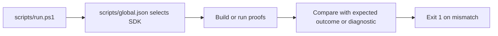

# Proof runners

Each skill with a proof runner keeps it under `skills/<skill>/scripts/`. The general proof rules are in [practices](practices.md). This file records the contract of each runner.

## IWSAM and environment capabilities

These runners run each proof script with `dotnet fsi` and print the inferred signatures of the main functions for inspection. Each `scripts/breaks/*.fsx` file must fail with its one expected FS code.

The IWSAM and environment proof runners use a `scripts/global.json` with SDK `10.0.100` and `latestFeature` roll-forward.
The runners select their script directory before invoking `dotnet`, so a parent SDK pin does not select F# 8.
F# 8 can report `FS0192` on the IWSAM examples. Preserve the SDK file when packaging these skills.
The examples use `FsToolkit.ErrorHandling` 5.2.0 for `result`, `validation`, and `taskResult`.
Do not add the obsolete `FsToolkit.ErrorHandling.TaskResult` package.

## Nullness interop

The nullness proof runner is project-based because nullness checks and `TreatWarningsAsErrors` are project properties.
It builds `scripts/Clean` and compares its printed null results. Each `scripts/breaks/*.fs` file is copied into its own temp project from `Break.fsproj.txt` and must fail with exactly the codes in its `// expect:` lines, and its output must contain each `// expect-text:` message.
The runner sets `FSHARP_NULLNESS_PROOF_ROOT` to a per-run temp directory. `scripts/Directory.Build.props` puts `bin` and `obj` there, and the runner deletes it.

An example from `scripts/breaks/IsNullNoNarrow.fs`. `isNull` does not narrow `v`, so the build fails with FS3261:

```fsharp
// expect: FS3261
let envOr (name: string) (fallback: string) : string =
    let v = Environment.GetEnvironmentVariable name
    if isNull v then fallback else v
```

## Signature files

The `fsharp-signature-files` runner is project-based and requires PowerShell 7.4. It reuses the nullness isolation files with `FSHARP_SIGNATURE_PROOF_ROOT`.
It builds `scripts/Sample` and checks lines of `scripts/public-surface.ps1` output: the abstract type and its constructor function are public, and the helper left out of the `.fsi`, the `val internal` helper, and the record field are not. It checks that the XML file has the `.fsi` doc comment and no entry for a doc comment that is only in the `.fs`. `scripts/Sample.Tests` calls a `val internal` value through `InternalsVisibleTo`.
It builds `scripts/Generate` with `-p:OtherFlags=--allsigs` and checks that `Orders.fsi` keeps the public helper, the `val private` value, and the doc comment, and that `.fsi` files appear under `obj/`.
Each `scripts/breaks/<Name>/` folder has its own `Break.fsproj`. The runner checks that the reported FS codes (warnings and errors) equal the `// expect:` codes. A folder with `// expect-exit: 0` must build, because FS3888 is only a warning.

`public-surface.ps1` runs `PublicSurface.fsx` with `dotnet fsi` from `scripts/`, so `scripts/global.json` selects the SDK. It loads the assembly in a collectible `AssemblyLoadContext` and prints one sorted line per exported type, base type, interface, and declared public member. Type names include the namespace. It lists operators such as `op_Addition`, and leaves out property and event accessor methods, because the property or event line shows them. It resolves dependencies from the assembly folder, the NuGet packages in `<Lib>.deps.json`, and the shared frameworks such as `Microsoft.AspNetCore.App`. The compiled parameter names come from the `.fs`, not the `.fsi`.

```text
Sample.EmailModule | static create(input: System.String) : Microsoft.FSharp.Core.FSharpResult<Sample.Email, System.String>
```

## Native AOT

The Native AOT proof runner is project-based because `dotnet fsi` cannot publish a native exe.
Its `scripts/` directory holds `Directory.Build.props`, `Directory.Build.targets`, and `Directory.Packages.props`.
These files stop parent MSBuild files, such as central package management, from changing the proof.
`Directory.Build.props` sends `bin` and `obj` to the system temp directory, so an installed skill contains no build output.
The runner compares each probe's JIT and native results with an expected verdict: `same`, `throws`, or `differs`.
Each metadata fix needs its own small exe. A fix in a shared exe keeps metadata for every probe in that exe.

## Async composition

The async composition proof runner runs `Proofs.fsx` with FSI and builds a `StateMachine` project in Release.
FSI does not report FS3511, so the state machine check needs a Release project build.
The runner reuses the Native AOT isolation files with its own temp artifact folder.
Write each `do!` and `return` on its own line in proof scripts. A one-line `async { do! x; return y }` gives FS0748.
The runner checks each outcome in `Proofs.fsx` and fails on a mismatch. It also checks that `StartCrash.fsx` stops the process and that the FS3511 warning occurs only in `Dynamic.fs`. It has no compile-time break tests and prints no inferred signatures.

## Failure paths

`FailurePaths.fsx` compares each outcome with an expected value and exits with code 1 on a mismatch. The failure-path runner has no compile-time break tests and prints no inferred signatures.

## Idiom review

The idiom review runner checks that each before form in `Idioms.fsx` gives the same result as its after form, and that `static member X = expr` runs `expr` on each access.

## Verify API

The `fsharp-verify-api` runner lists Expecto 10 and 11, `FSharp.Core`, and extension members through `scripts/show-api.ps1`. It fails when an expected member is missing or a removed member is present.
`ShowApi.fsx` prints F# source names from `CompilationSourceNameAttribute`, so `ListModule.TryHead` shows as `tryHead`. It also lists extension methods whose first parameter is the type or one of its bases.
`show-api.ps1` writes a temporary `.fsx` with a pinned `#r "nuget: ..."` line and runs it from `scripts/`, so `scripts/global.json` selects the SDK.
A lookup that the skill recommends must exit 0 when a member is missing, because the eval runner counts each non-zero `dotnet fsi` call as a failed build. See [eval effort metrics](eval-effort-metrics.md).

```powershell
pwsh ./skills/fsharp-verify-api/scripts/run.ps1
```



See [practices](practices.md) for the general proof rules and [terminology](terminology.md) for proof script and compile-time break test.
