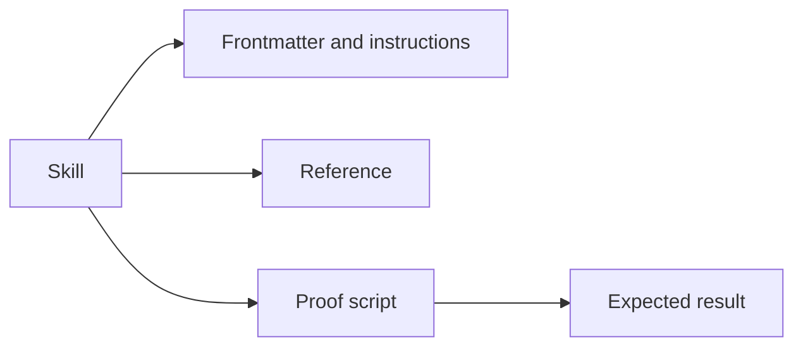

# Terminology

- Skill - A directory with a `SKILL.md` entry point and optional supporting resources.
- Frontmatter - YAML metadata at the start of `SKILL.md`, including `name` and `description`.
- Reference - Supporting documentation loaded when the skill needs it.
- Proof script - A runnable example that demonstrates a skill claim.
- Compile-time break test - A check that an intentionally invalid program fails compilation for the expected reason.
- Lode - Persistent project knowledge under `lode/`.
- Native AOT - .NET ahead-of-time compilation to a native exe, enabled by `PublishAot`.
- Probe - A named case in a proof app whose output the runner compares between builds.
- Grader probe - An F# script that a grader runs with the agent's code. It calls the agent's functions, often with fake dependencies, and prints one PASS or FAIL line for each check.
- JIT-versus-native diff - A comparison of the same probe output from `dotnet run` and from the native exe.
- Eval - A task that an agent runs with and without a skill, graded by a script.
- Grader - A script that checks an agent's output and writes `grading.json`.
- Baseline - An eval run without the skill.
- Contamination - A global skill on the same subject that a baseline run can load.
- Rubric - Yes/no questions in an eval task that a judge model answers about the agent's diff.
- Judge - The separate model command that answers rubric questions. It sees only the diff and the questions.
- Turn - One agent step in an eval transcript. Each agent counts it differently (see `evals/README.md`).
- Failed build call - A shell command that runs `dotnet build`, `dotnet test`, `dotnet run`, or `dotnet fsi`. It also exits with a non-zero code or prints an `error FS<number>` line. [evals/README.md "Effort metrics"](../evals/README.md#effort-metrics) gives the parse rules.
- Fault injection - A grader step that calls the agent's code with failing input (empty input, missing key, failed dependency) and checks that each failure returns an `Error` that names its cause.
- Failure path - The code path that runs when a call can fail. A silent failure path crashes at runtime or hides the failure behind a default.
- Public surface - The sorted list of exported types and public members of a built assembly, as `skills/fsharp-signature-files/scripts/public-surface.ps1` prints it.
- Probe consumer - A small project that a grader builds against the agent's library. A control probe must build; a must-fail probe must not compile.
- Settings DTO - A `[<CLIMutable>]` record that the configuration binder fills. Only the composition root reads it. A parse function turns it into the validated settings type.
- Composition root - The startup code that reads configuration, builds the container, and builds the env. It is the only code that can use `IOptions<T>` or `IConfiguration`.
- Reference solution - A fast implementation that a grader owns. A performance check runs it in the same process as the agent's code and sets its allocation and time limits from it.
- Wire contract - The JSON shape that another service or a stored record expects for each type: property names, union shape, optional and required fields, and unknown properties.
- Saved sample - A JSON file that another service or an older version of the code wrote. Tests decode it and compare the encoded value with it. A sample regenerated from new code is not a saved sample.
- Silent data loss - Native exe output that has less content than the JIT output, with no exception.
- Binary compatibility - A consumer that was compiled against v1 of a library runs with the v2 DLL, with no rebuild, and gives the same results. A successful build proves only source compatibility.
- Old consumer - A consumer binary that was compiled against the baseline library and runs with the new DLL in place of the old one.
- Cross-assembly inlining - In a Release build, the F# compiler copies small function bodies from the optimization data in a referenced F# DLL. `--nooptimizationdata` on the library stops it, except for `inline` functions.

Use these terms consistently in the Lode, `evals/README.md`, and skill documentation. A failure alone does not prove the expected compiler constraint.

Example proof-script invocation:

```powershell
dotnet fsi ./skills/<skill-name>/scripts/<proof-name>.fsx
```


