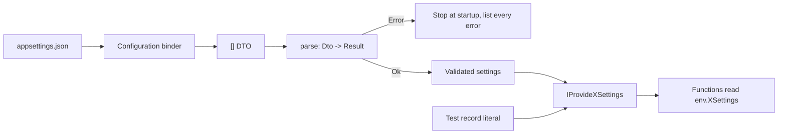

# Settings as a capability

The code blocks below come from [scripts/Settings.fsx](../scripts/Settings.fsx), shortened where
marked with `...`. The script checks at least one cell in each row of the binder table and each startup
result, and exits with code 1 on a mismatch.



## Binder rules for F# types

`configuration.Get<T>()` and `services.AddOptions<T>().Bind(section)` fill the type through
`Microsoft.Extensions.Configuration.Binder` 10.0.0. The results for F# types:

| Field type | Key present | Key absent |
| --- | --- | --- |
| `string` in a `[<CLIMutable>]` record | value | `null` |
| `int` or `decimal` in a `[<CLIMutable>]` record | value. Text that does not convert throws `InvalidOperationException`. | `0`, with no error |
| `Nullable<int>` | value | `null` |
| `string[]`, `IReadOnlyList<string>` | value | `null` |
| `string list` | throws `InvalidOperationException` (the binder calls the `FSharpList` constructor) | `null` |
| `string option` | `None`, even when the key has a value | `None` |
| nested `[<CLIMutable>]` record | value | `null` |
| record without `[<CLIMutable>]` | binds through its constructor | throws, and names only the first missing parameter |

`section.Get<T>()` returns `null` when the section is missing. `AddOptions<T>().Bind(section)`
returns an instance with every field at its default. In the Options form, the parser therefore
reports each required key, not the missing section.

Consequences:

- Bind to a `[<CLIMutable>]` DTO. Use `Nullable<_>` for a required number, so that a missing key
  differs from `0`. Use arrays for lists. Do not put `option` or `list` in the DTO.
- Treat every reference field as possibly `null`, including the DTO itself and nested records.
- The DTO is for the binder only. Functions read the parsed type.

## Parse with Result

Parse the DTO into the settings type and collect every error. The `validation` expression from
FsToolkit.ErrorHandling runs each `and!` and keeps all errors. The `parse-dont-validate` skill
covers private constructors for the parsed type.

```fsharp
let parse (dto: MailSettingsDto) : Result<MailSettings, string list> =
    match Option.ofObj (box dto) with
    | None -> Error [ "the Mail section is missing" ]
    | Some _ ->
        validation {
            let! host = required "Host" dto.Host
            and! port = port dto.Port
            and! from = required "From" dto.From
            and! retry = retry dto.Retry
            return { Host = host; Port = port; From = from; Recipients = ...; Retry = retry }
        }
```

Name the configuration key in each error. The reader fixes `appsettings.json`, not the F# code.

## Fail at startup

Pick one of two forms.

Parse in the composition root when nothing else in the app uses Options for this section:

```fsharp
let settings =
    match configuration.GetSection("Mail").Get<MailSettingsDto>() |> MailSettings.parse with
    | Ok settings -> settings
    | Error errors -> failwithf "Invalid Mail settings:\n  %s" (String.concat "\n  " errors)

services.AddSingleton<MailSettings>(settings)
```

Use `IValidateOptions` when the app already binds the section with Options. The validator calls
the same parser:

```fsharp
type MailSettingsValidator() =
    interface IValidateOptions<MailSettingsDto> with
        member _.Validate(_, dto) =
            match MailSettings.parse dto with
            | Ok _ -> ValidateOptionsResult.Success
            | Error errors -> ValidateOptionsResult.Fail errors

services.AddOptions<MailSettingsDto>().Bind(configuration.GetSection "Mail").ValidateOnStart() |> ignore
services.AddSingleton<IValidateOptions<MailSettingsDto>, MailSettingsValidator>() |> ignore
services.AddSingleton<MailSettings>(fun sp ->
    match MailSettings.parse (sp.GetRequiredService<IOptions<MailSettingsDto>>().Value) with
    | Ok settings -> settings
    | Error errors -> invalidOp (String.concat "; " errors))
```

`ValidateOnStart` only registers the check. A generic host runs it when the host starts. These
scripts do not start a host. With a bare
`ServiceCollection`, nothing runs it: `BuildServiceProvider` succeeds, the env resolves, and the
error comes at the first function that reads `env.MailSettings`. Run the check yourself before
the app does work:

```fsharp
provider.GetRequiredService<IStartupValidator>().Validate()
```

`IStartupValidator` exists only when some registration calls `ValidateOnStart`. In the
composition-root form, `GetRequiredService<IStartupValidator>` throws `InvalidOperationException`.

For one bad section, `Validate` throws `OptionsValidationException`. For two or more bad sections,
it throws `AggregateException` with one `OptionsValidationException` for each section. Collect the
errors from both shapes:

```fsharp
let validationFailures (error: exn) =
    match error with
    | :? OptionsValidationException as e -> List.ofSeq e.Failures
    | :? AggregateException as e ->
        [ for inner in e.InnerExceptions do
              match inner with
              | :? OptionsValidationException as o -> yield! o.Failures
              | other -> yield other.Message ]
    | other -> [ other.Message ]
```

## Expose the parsed type

One accessor for each settings section. The accessor exposes a plain value, so the rule that an
accessor never exposes a concrete class does not apply.

```fsharp
type IProvideMailSettings =
    abstract MailSettings: MailSettings

module Mail =
    let route (env: #IProvideMailSettings) (recipient: string) =
        let settings = env.MailSettings
        ...

type AppEnvironment(services: IServiceProvider) =
    interface IAppEnvironment with
        member _.Logger = services.GetRequiredService<ILogger>()
        member _.MailSettings = services.GetRequiredService<MailSettings>()
```

`IOptions<T>`, `IOptionsSnapshot<T>`, and `IConfiguration` stay in the composition root. A
function that takes `IOptions<T>` reads the DTO, so it can see unparsed values. Its test also
needs `Options.Create`.

A composite infers the settings capability with the others:

```text
val it:
  ('a -> string -> string)
    when 'a :> Settings.IProvideMailSettings and 'a :> Settings.IProvideLogger
```

## Test env

A test env returns a record literal. It needs no configuration, no container, and no Options type:

```fsharp
let testEnv =
    { new IProvideMailSettings with
        member _.MailSettings =
            { Host = "localhost"; Port = 2525; From = "test@example.com"; Recipients = []; Retry = Some { Attempts = 3 } } }
```
